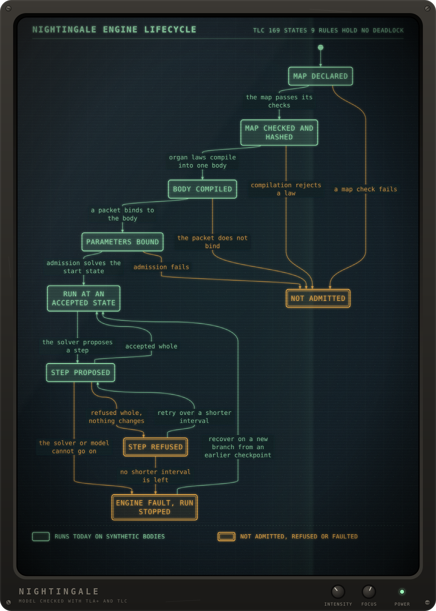

# Nightingale

Nightingale is a Rust simulation of one patient's body, for teaching. It does not inform the care of a real person. Pressures, flows, lab values and other readings are meant to be computed from conserved amounts (water, salts, gases, heat) and from physics, so illness, chance and treatment would later act on the same body. Numbers in this repository are synthetic. Clinical values may enter only in a reviewed packet, and none is here.

<br>The chart shows the engine lifecycle the contract defines, and only the map check runs today. Its TLA+ model, which TLC checks, and the script that redraws it are in [docs/statecharts](docs/statecharts).

## Why it matters

A monitor and a chart can both describe one patient and still disagree. The design keeps those facts apart. Body state is computed. A chart entry is what a clinician documented. An observation is a reading taken from state, and it never writes back. No code is allowed to assign a vital sign. The same patient and the same inputs are meant to give the same result after a pause or a replay. The first milestone, in [record 0004](docs/adr/0004-first-milestone.md), is not yet run. It is a healthy reference adult man through two ordinary days of sleep, meals, posture and room air. It would pass only if amounts balance, readings stay inside healthy ranges for what he is doing, and later mornings meet his own morning anchors.

## How it is built

Rust 1.98.1, edition 2024, one Cargo workspace, `unsafe` code forbidden. Laws are data. One time step is meant to run in this order:

1. `ng-contract` would compile anatomy and laws into one body.
2. A solver, not a crate yet, would propose the next state and see only that body.
3. `ng-record` would accept or refuse the whole step and keep the ledger.
4. `ng-observe` would read the accepted step and would not write.
5. `ng-validate` would check conservation and compare solvers. It sits outside that path.

The four crates under `crates/` compile. `ng-contract` holds the anatomy: it checks a map of the body's sites and gives it a hash. The other three are each only a comment naming their role. The type sketch they are meant to grow into is [solver-contract-sketch](docs/architecture/solver-contract-sketch), and its function bodies are `todo!()`. Heart and vessels, fluids, kidney, nerves, receptors and the solver are modules there, not workspace crates. Read [the requirements](docs/srs.md), [decision records](docs/adr), [the 13-system atlas](docs/atlas), [the glossary](GLOSSARY.md) and [the solver contract](docs/architecture/solver-contract.md). nightingale-pulse is a private reference implementation. This tree does not build or run against it.

## Build

Python 3.11 or newer, and the toolchain pinned in `rust-toolchain.toml`. From a clone:

```sh
.agents/skills/verify-nightingale/ensure-prereqs.sh
cargo check --workspace --locked
cargo test --workspace --locked
cargo check --locked --manifest-path docs/architecture/solver-contract-sketch/Cargo.toml
cargo test --doc --locked --manifest-path docs/architecture/solver-contract-sketch/Cargo.toml
tools/verify
```

There is no program to run. Workspace tests check the anatomy on synthetic maps. The sketch's doctests check the API shape, including forms that must fail to compile. The first command installs the pinned toolchain and, when git has no hook path yet, turns on this repo's pre-push check. `tools/verify` is the merge check.

## What is in place

Requirements, decision records, the atlas and the solver-contract sketch are written, and the sketch type-checks. The workspace crates compile and do not simulate a patient. Disease, treatment, a bedside monitor and learner scenarios are specified and not implemented.
