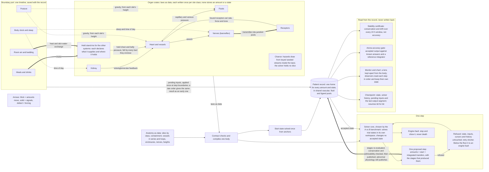

# Solver and core contract

## Problem

Nightingale needs one body model that either numerical core can solve without knowing an organ exists, and one record that accepts a step only after the whole step is checked. Four constraints make the shape non-obvious. Organ authors must state laws with no dt, solver or record in reach. The record must stay the only owner of accepted state (pulse 0006:70; pulse 0003:14). Every pace must give the same trajectory (pulse 0006:29). Conservation must close at the incidence step, not in an audit afterwards. This document is the synthesized design: laws are data compiled by the contract, with three ideas from the other candidate and the repairs the cross-vendor review required. It is a type sketch and a rationale, not an implementation.

Completion here means the standalone sketch (`solver-contract-sketch/`) passes `cargo check --all-targets` with warnings denied and every doctest: the three call sites below, the external signature walk (`src/signature_walk.rs`), and the compile-fail doctests with legal twins (`src/lib.rs`). The coupling census is counted by the compiler. It does not mean either core already meets the 48 h certificate, the accuracy gate or the speed bar; the arena measures those. Revision r1 adopted findings from an outside review of the diagram; [solver-contract-review-r1.md](https://github.com/ShanesNotes/nightingale-pulse/blob/bdc01c567f6cadacbd96728c0600a2e052882a59/docs/architecture/solver-contract-review-r1.md) has the triage. The slice is pulsatile CV, FL, RN, the **minimal NS baroreflex**, the receptor layer and the boundary, 48 simulated hours, synthetic numbers.

Binding constraints: `docs/srs.md`, whose hard rules carry pulse 0002 to pulse 0004 and pulse 0006's contract picks, and [pulse 0006:20–35](https://github.com/ShanesNotes/nightingale-pulse/blob/bdc01c567f6cadacbd96728c0600a2e052882a59/docs/decisions/0006-first-milestone-stable-healthy-body.md#L20-L35). The record owns accepted state; observation never writes physiology; there is no output setter, private material store, numerical-fault death, pace-dependent trajectory or runtime dependency on the Pulse path. Contract-A means `ng-contract`, contract-B `ng-core-contract`; solver-A is the compiled conservation graph, solver-B the beat-synchronous ledger stepper. The pairs never mix.

Sources: **CA** = [pulse contract pass 1, candidate A](https://github.com/ShanesNotes/nightingale-pulse/tree/bdc01c567f6cadacbd96728c0600a2e052882a59/docs/council/2026-10-26-contract-pass-1/raw/a-unknown-model/ng-contract); **CB** = [pulse contract pass 1, candidate B](https://github.com/ShanesNotes/nightingale-pulse/tree/bdc01c567f6cadacbd96728c0600a2e052882a59/docs/council/2026-10-26-contract-pass-1/raw/b-unknown-model/ng-core-contract-draft1); **SA**, **SB** = pulse solver pass 1, [candidate A](https://github.com/ShanesNotes/nightingale-pulse/tree/bdc01c567f6cadacbd96728c0600a2e052882a59/docs/council/2026-10-26-solver-pass-1/raw/candidate-a) and [candidate B](https://github.com/ShanesNotes/nightingale-pulse/tree/bdc01c567f6cadacbd96728c0600a2e052882a59/docs/council/2026-10-26-solver-pass-1/raw/candidate-b); **FU** = `~/lanes/logs/ng-q1-frame-followup.md` (outside the repo, sha256 `c79e0e58b35e7f6be618cd23c2a760173201be02416633b930b89dae3faaeb10`); **MAP** = `docs/atlas/coupling-map.md`.

## Usage (caller's view)

These three call sites are the specification the sketch was derived from; each compiles as a doctest. No fragment or kernel receives a record, solver, interval, dt, wall clock or RNG cursor. The sketch bodies are `todo!()`.

### (a) The RN author declares the kidney

```rust
use solver_contract_sketch::ng_contract::*;
use solver_contract_sketch::ng_renal::{filtration_law, RenalParameters};

fn kidney<'b>(scope: RenalScope<'b>) -> Fragment<'b, Renal> {
    let (mut laws, ports) = scope.parts();
    let parameters = RenalParameters::declare(&mut laws);
    let inputs = ports.filtration_inputs;
    let rate = laws.kernel(|graph| filtration_law(graph, inputs, &parameters));
    laws.transfer(Transfer::new(&ports.filtration, rate));
    laws.finish()
}
```

The scope grants renal capabilities once; RN never sees a pool name. `ports.filtration` names both registry endpoints of the glomerular-water route and cannot be split, used by a CV law, or built from a donor alone. `laws.kernel` opens one closed expression graph with a fresh lifetime, so nothing read inside it can leak into another kernel. `RenalParameters::declare` declares parameter slots (Kf, feedback gain) by key; their values arrive later from a bound packet. Coupling-map arrows come from the generated catalog: RN emits tubuloglomerular feedback with `laws.emit::<TubuloglomerularFeedback<_>>()` and defines each field once, and it can `receive` only arrows the map draws to RN. There is no renal `post(rate * dt)` or `evolve`; a memory slot's rate is declared with `memory_rate`, and the contract integrates it. The compiler refuses this partial fragment in a full renal schema because other laws are missing; it is a valid filtration-bench declaration.

### (b) The runtime steps a session: accept, refuse, fault, checkpoint, resume, rewind

```rust
use solver_contract_sketch::ng_contract::*;
use solver_contract_sketch::ng_record::*;

fn advance<'m>(session: Session<'m, Running>)
    -> Result<(Session<'m, Running>, StepReceipt), Session<'m, Faulted>> {
    let mut attempt = session.step();
    loop {
        attempt = match attempt {
            Step::Accepted(session, receipt) => return Ok((session, receipt)),
            Step::Refused(session) => session.retry(),
            Step::Faulted(stopped) => return Err(stopped),
        };
    }
}

fn save_resume_rewind<'m>(session: &Session<'m, Running>, body: &'m CompiledBody,
    solver: &'m dyn CoupledSolver, store: &mut dyn HistoryStore, fork: BranchId)
    -> Result<(Session<'m, Running>, Session<'m, Running>), CheckpointError> {
    let saved = session.checkpoint(store)?;
    let bytes = Checkpoint::from_bytes(saved.as_bytes().to_vec());
    let resumed = Session::resume(&bytes, session.record().identity(), body, solver, store)?;
    let forked = session.rewind(&saved, fork)?;
    Ok((resumed, forked))
}

fn after_fault<'m>(stopped: Session<'m, Faulted>, earlier: &Checkpoint,
    store: &mut dyn HistoryStore, fork: BranchId) -> Result<Session<'m, Running>, CheckpointError> {
    let _diagnosis = stopped.export(store)?;
    stopped.recover(earlier, fork)
}
```

`step` runs `next_step`, `PatientRecord::attempt` and `publish` inside the session. A refusal means nothing changed: amounts, stream positions, commands, pending inputs and history are untouched. The session becomes `Session<Retrying>`, which has no `step`, so a host cannot drop a refusal and restart the budget, and `retry` solves the same base over a strictly smaller interval, never below the resolution's declared minimum. An `EngineFault` from any stage, including an exhausted retry budget, latches the session as `Session<Faulted>`, which has no `step`. It can be inspected, exported for diagnosis, or continued only by `recover`, which opens a new branch with ancestry from an earlier checkpoint. How the product presents a stopped session stays open (nightingale-pulse#293). A checkpoint is the whole accepted image, and an observer checkpoints its outputs beside it; `resume` continues the branch it holds, and `rewind` forks without resetting the parent.

### (c) The arena scores a 48 h run

```rust
use solver_contract_sketch::ng_contract::*;
use solver_contract_sketch::ng_validate::*;

fn measure(body: &CompiledBody, solver: &dyn CoupledSolver, cores: &dyn CoreFactory,
    initializer: &dyn Initializer, spec: ArenaSpec, policy: &CertificatePolicy, cases: &AccuracyPolicy)
    -> Result<ArenaScore, ArenaFailure> {
    let checked = accuracy(solver, cases).map_err(ArenaFailure::Accuracy)?;
    let replay = replay_gates(body, cores, initializer, &spec)?;
    let run = run(body, solver, initializer, spec, Pace::Unbounded)?;
    let certificate = certify(&run.record().conservation(), policy)
        .map_err(ArenaFailure::Certificate)?;
    score(certificate, checked, run.into_evidence(), replay)
}
```

`ArenaSpec` accepts only a `ParameterPacket<SyntheticFixture>`, so the arena is nonclinical by type. `accuracy` runs the same core on manufactured cases with known answers and against the reference integrator, because a step can close every ledger and still be wrong; a score needs its evidence. `certify` takes one `ConservationView` lent by one record and policy data; it cannot take a vital, a waveform or two histories. Wall time and replay evidence are collected beside the record, never inside the certificate. Both cores receive the same compiled body, fixture packet, boundary timeline and protocol.

## Shape

### Data first

The dominant structures, in the order data flows:

1. **`Anatomy`**: sites, each of one site class, with containment, flow networks, enclosures, served-by edges and positions. `Schema::new` derives the pool registry from it. Organs are regions of it, not owners of it.
2. **Fragments** from organ crates: capabilities, closed kernels (whole-body or per site class) and parameter slots, branded by assembly and owner.
3. **`CompiledBody`**: dense immutable arrays (pool registry, paired transfer columns, balanced reactions, work claims, one expression program, equation rows, guards, dependency blocks, CSR pattern, conserved basis, parameter layout) and a model hash.
4. **`BoundParameters`**: packet values in compiled order, with provenance and the packet's evidence manifest.
5. **`PatientRecord`**: the accepted image (state, solver continuation, last dense segment, stream positions, pending inputs) and one sealed history of ledger chunks. No observer state.
6. **`CoupledProblem`**: body, values, identity, base seal and accepted view, built by the record for one attempt.
7. **`StepProposal` → `VerifiedStep` → `NextImage` → `StepReceipt`**: one transaction.
8. **`ConservationView` → `Certificate`**.
9. **`ObservationLens` → `ObservationView` → `Observer`**: a lens compiled against the body but hashed apart from it, a read-only view of one accepted revision, and an observer that holds its own state.

The paths are direct: anatomy → schema; organ → fragment → compiler; solver → problem → proposal; record → validate → publish; record → view → certificate; record → lens view → observer. No later ad hoc map is needed in the hot loop (per foundational-thinking and model-the-domain).

**Interface depth.** A solver sees one problem of about a dozen methods, a workspace and a quadrature. Behind them sit dependency analysis, sparsity, block partitioning, incidence, extent reconstruction, the conserved basis, identity hashing and history sealing; no core re-implements any of them. Organ authors see scopes, kernels and the catalog, never layouts, rows or pools. Validation lives at the boundaries (per boundary-discipline): `bind` parses packets, `BoundaryPort::new` parses timelines, `restore` checks identity before any body byte, and `validate` decides acceptance once; inside, typed values are trusted. The contract deliberately has no organ callback, no record access from a law, no dt in a law, no amount or output setter, and no conversion between failure kinds.

### 1. Organ declarations are consumable, typed data

`ng-renal`, `ng-cardiovascular`, `ng-fluids`, `ng-nervous` and `ng-receptor` return `Fragment<'b, Owner>`; there is no runtime `Organ` trait and no organ object survives compilation. This keeps CA's owned handles and deterministic registry but replaces string lookups and runtime bind errors with assembly-scoped capabilities (CA/src/id.rs:26, CA/src/organ.rs:88–155), and it adopts CB's complete-law coverage, including an explicit zero kernel for an inactive mode (CB/src/numerics.rs:87–100). An omitted law is not zero.

**No organ owns a pool**, so no organ can name one: the `(site, species)` registry belongs to the body and its amounts to the record (MAP:7–20). An endpoint capability refers to the registry under one law's authority; it carries no amount and no public pool id (`PoolRef` is private). `Assembly` issues each scope once under an invariant lifetime brand. `Pair<Owner, Q>` needs both ends with one species and unit. `StateSlot<Owner, U: NonMaterial>` excludes water, ions, mass and energy.

**Laws attach by reference.** Declaring a memory or algebraic slot, requesting a route family through a scope's port (`ports.starling(&mut laws)`) or naming a water boundary in the schema records a law the body owes. `memory_rate`, `residual`, `transfer_at`, `transfer_along` and `transfer` borrow the slot, route or pair, and each kernel's own `ModeSet` says where its law holds, so compilation sees every law on a row together. It refuses a row no law defines (`OmittedLaw`), two laws that hold in one mode (`SecondOwner`) and a mode value no law covers (`UncoveredMode`), each naming the law by its owner's card and the slot, mode variable, route family or boundary it serves. A scope issued and never added is refused too, so dropping a builder never drops what it owed.

**Kernels are closed expression graphs**, not callbacks. `FragmentBuilder::kernel` hands its closure a `Kernel<'b, 'k, Owner>` whose `'k` is fresh and invariant (`src/ng_contract/law.rs`), so an `Expr` from one kernel, finished or still open, does not type-check in another. The closure runs once, at declaration, and only builds the graph; no solve ever calls it. Reading a port adds the dependency; the dependency set is the structural sparsity, so there is no hand-written sparsity list and no way for dependencies and output to describe different programs. Operators carry unit signatures from a pinned, versioned instruction set. An `Expr` carries no value, so a kernel cannot call host math; transcendental operators such as `exp` are the contract's own routines (§3, replay). A future primitive needs a contract version, not an escape hatch.

**Admissible is not normal.** A trial can be refused for leaving a set in only three places: a pool's amount below zero, a memory or algebraic slot outside its `Admissible` set (one of `finite`, `nonnegative`, `positive` or `unit_interval`; there is no constructor with bounds), and an operator's own precondition, such as a logarithm's positive argument. A kernel's output takes no set, so a sign constraint cannot be put on a computed expression such as `pressure − reference`. Refusal is followed by a smaller retry, as SUNDIALS does with sign constraints (IDA §5.2.2.4, ARKODE §2.2.17). Where a law's form is trusted is a separate `ValidityRange` with its basis, declared with `FragmentBuilder::validity`. An accepted state outside it publishes and the receipt records a `ValidityExcursion`; it never refuses or faults. Types close the direct routes. A law can still encode a threshold through an operator's precondition or a slot's dynamics, so `CompiledBody::refusal_sources` lists every source with its law and `NumericalHealth` counts refusals per source. A deteriorating patient keeps publishing until physiology, not the solver, ends the run (pulse 0004).

**Modes are declared values.** `FragmentBuilder::modes` declares one discrete mode variable of the owner and returns its values. `Mode::only` gives the `ModeSet` a kernel holds in, and `Mode::to` gives the `ModeTransition` a guard fires; it refuses the same value or a value of another variable. `Guard::new(zero, crossing, transition)` keeps the zero kernel's own dimension (a valve's guard is a pressure head), and `event` declares it. Compilation requires each guard's kernel to hold in the mode it leaves, and initialization picks starting values consistent with the guards. The signature walk declares a valve that opens on a rising head and shuts on a falling one.

**Anatomy is data, and laws are written per site class.** The schema is an `Anatomy` (`src/ng_contract/anatomy.rs`): sites, each of exactly one class from a closed set (`CapillaryBed`, `VesselSegment`, `Junction`, `EnclosedSpace`, `TissueSite`, `NerveSegment`), and five relations over them. Containment is a tree whose named nodes are regions, so an organ or a territory is a set of sites and its totals are exact sums. Flow networks (vascular first, then lymph, airway, ducts and CSF) are directed graphs in which beds in series (glomerular then peritubular) and loops (the circle of Willis) are ordinary edges. An enclosure surrounds beds and answers the volume inside it with one `Compliance` law: rigid, elastic, or `Held` by a named stand-in, which owes one law on one pressure row per enclosure. A served-by edge joins a site to the nerve segment it reports to, with its `Afferent` kind and block and lesion parameters keyed by the edge. Every site has a `Position` in the body frame, so hydrostatic head follows from posture in one place. `AnatomyBuilder::finish` refuses an unreachable or undrained bed, a site with two enclosure chains or no position, a containment cycle and an orphan site. A finer map is a new anatomy and a new model hash; no law changes. A law is declared once for a class. `FragmentBuilder::site_kernel::<C>` builds a `PureKernel<.., C>` whose graph reads its own site's entry of a `PerSite<C, U>` port (`Kernel::at_site`) and site-keyed parameters. `transfer_at` attaches it to a `SiteRoute<C, Q>`, one column per site. `FragmentBuilder::edge_kernel` builds one kernel for every vascular edge, reading its own edge's entries (`Kernel::at_edge`) and each end's own site parameter (`upstream_parameter`, `downstream_parameter`), and `transfer_along` attaches it to an `EdgeRoute<Q>`, one column per edge. A capillary-bed law cannot read a junction's entry, and a whole-body kernel cannot read a site entry at all. FL's Starling exchange is one declaration for every bed, NS releases and clears transmitter at every junction, and CV reads each vessel segment's hydrostatic head. Each bed's extravascular pressure comes from its nearest enclosure, which replaces the separate pleural and abdominal wires. A bed nothing encloses reads zero gauge, and a law that reads a bed in a rigid or elastic enclosure is refused until that compliance has a law. `Representation::Reduced { region }` marks a grouped region's law with the region it stands for. `CompiledBody::aggregation(region)` gives a region's exact book totals over its sites, in compensated arithmetic and with no new state.

**The schema states what the body leaves out.** Beside the anatomy, the `Schema` holds the composition data no law sees: each named water boundary with its site and space (`Schema::water_boundary`), whose law is owed whether or not a boundary scope is issued; the fixed partial-volume coefficient that `Kernel::volume` reads; and the spaces this body does not model, each with its reason (`Schema::leave_out`). Every other registry pool is an amount that some transfer must move. A pool that none moves and no declaration holds is an orphan, so a forgotten scope or route is refused instead of silently leaving the state. A held declaration names the spaces its card stands behind, and a held enclosure's own fluid comes with it. A held pool stays an amount with a row, one card holds it, and a law that moves one is refused. A law that moves or reads a left-out pool is refused, and a read never counts as moving. Left-out spaces and their reasons enter the model hash.

**Refinement.** A grouped region may be replaced by its subtree only when all of these hold:

- the port sets are equal and the subtree's aggregates obey the same books;
- port behavior matches within a declared envelope on manufactured cases, and loop margins hold;
- sensors on the region are remapped;
- only the anatomy and the packet change, and the whole-body regression passes.

 A refined anatomy states this as a `RefinementRule` (`AnatomyBuilder::refines`): the grouped and replacement regions, `SplitRule`s whose children each carry their own weight and derive their values as `Derived` identities of the parent, the sensor remapping, and a `PortEquivalence` naming the ports, envelope, manufactured histories, tolerance, loop margin and regression. The rule is a request for that evidence, never a certificate that it ran. With no new data, a refined body starts equivalent to the grouped one. A refined body is a new model; there is no mid-run zoom. The port-equivalence gate is built at the first deepening after the milestone; the data shape affords it now.

**Instruction set v1.** `multiply` and `divide` return `Product<A, B>` and `Quotient<A, B>`, which become a named dimension only through the sealed `SameDimension` table (`Product<Elastance, Volume>` is a `Pressure`); volume times volume cannot be cast to a pressure. `scale` multiplies by a dimensionless factor. `smooth_max` and `smooth_min`, `0.5 (a + b ± sqrt((a − b)² + w²))` with `w` a declared parameter, give limits and waterfalls a continuous Jacobian. `logistic` is built from the pinned `exp`, and `ln` lists its positive argument as a refusal source, like `divide`'s divisor. Each operator uses only correctly rounded IEEE operations and the contract's own routines, so it replays bit for bit.

**Set points are their own dimension.** `FragmentBuilder::set_point` declares slow memory of dimension `Reference<U>`, in the unit of the variable it guards (a pressure, a temperature, a stretch). It is `NonMaterial`, so it is memory like any other and moves by `memory_rate`, but it is not `U`: no law can add, subtract or relax across the two. Only a `Sensed` dimension (dimensionless, pressure, volume, temperature, length) has a set point, and a `Reference` is never sensed, so no guard fires on a set point itself. `Kernel::deviation(measured, reference)` is the one operator that compares them. History and disease shift set points, gains and states; nothing writes the guarded variable.

**Chance lives in the laws.** `FragmentBuilder::stream` mints a `Stream` under a stable key (owner and name), which enters the model hash, so adding a stream renumbers no other. Declaring one owes a guard: compile refuses a stream no guard draws on, and a second guard on one stream or one integral, because one reset cannot serve two thresholds. A draw is a pure function of the run seed, the stream's key and its ordinal: the word at that index of one keyed mixer, mapped to the open interval (0, 1), with the seed's domain in its word. `Kernel::draw(&stream)` reads it, constant until the next event; a beat or breath guard declared with `Guard::advances(&stream)` moves it to the next ordinal when the image publishes. A hazard is memory whose rate physiology and treatment set, attached with `memory_rate` and holding where its `ModeSet` says. The contract integrates that rate's positive part, so an integral never falls, and a published value below the draw rules out a crossing at any earlier instant, whatever the step. `HazardGuard::new(&integral, &stream, transition)` fires when the integral reaches the stream's exponential draw, `-ln u`, while its mode variable holds the value the transition leaves, and it fires within a floor of arming if the integral is already past. On publication the contract resets the integral, advances the stream and applies the mode change together, and a refusal discards all three. Every law is read again on what a firing leaves: a law with no value there refuses the trial before anything waiting shows, so the fault falls short of the crossing and names that law, and a range is judged on both sides of the instant. Among guards racing for one mode variable in one landing the first in stable order fires, and the others did not happen: each keeps its integral and its draw. Only a guard armed before any guard fires can fire, so a guard a firing arms waits for the next step. A segment ends at a reset's left limit, so a chord never runs through one. Better care lowers the rate, so the same dice give a later event or none. Smooth variability tied to the clock is a `Forcing`, whose period and amplitude are packet values, declared with it by key, and `bind` refuses a period that is no whole number of nanoseconds: seeded knots in (-1, 1) with mean zero, interpolated by a cubic B-spline `s`, a pure function of seed, key and knot index. `Kernel::forcing` reads the factor `1 + a s(t)` at the stage's instant, positive with mean one, so a law scales a rate by it and needs no literal one. Knots are not breakpoints, so a forcing never cuts a step and replay holds at any pace or step policy. Variability modulates rates and never injects an amount. The solver holds no dice: `CoupledProblem` has no `threshold`, a proposal has no field for an event, and modes and stream positions live once, in the accepted state.

The forbidden moves fail to compile (`src/lib.rs`; each probe added since the first eight has a passing legal twin beside it, except the publish one, whose legal path is `Session::step`):

| Move | Error |
|---|---|
| Name or hold a pool (`PoolRef`) | E0603 |
| Write a vital (`set_mean_arterial_pressure`) | E0599 |
| Transfer from a donor alone | E0308 |
| Read another crate's internals | E0603 |
| Anchor without a citation | E0061 |
| Convert an engine fault to demise | E0277 |
| Hide material in private state | E0277 |
| Use another owner's route | E0308 |
| Carry an expression into a later kernel / into a kernel open inside another | E0521 / E0521 |
| Read a coupling the map draws to another card | E0271 |
| Certify one record's inventories against another's ledger | E0599 |
| Step a faulted session | E0599 |
| Step a refused session | E0599 |
| Publish outside the session | E0596 |
| Put a synthetic anchor in a reviewed packet | E0308 |
| Fire another owner's mode transition | E0308 |
| Pass bytes as split qualification | E0308 |
| Give a refusal domain bounds (a reference range) | E0599 |
| Put a sign constraint on a computed expression | E0061 |
| Build a split trace from invented samples | E0599 |
| Hold a card without declaring what it supplies | E0061 |
| Book extents as one sampled rate times the step | E0451 |
| Write a reaction from raw stoichiometry | E0451 |
| Call host math on an expression | E0599 |
| Read a junction's entry in a capillary-bed law | E0308 |
| Use a set point as the variable it guards | E0308 |
| Name a product by cast (volume times volume as a pressure) | E0277 |
| See the boundary timeline from a core | E0599 |
| Fire a guard on a set point | E0277 |
| Draw chance on the solver seam | E0599 |
| Draw measurement error from the run seed | E0308 |
| Ask a problem for a ticket | E0599 |
| Reach the timeline through an accepted view | E0609 |
| Take an input on a refused session | E0599 |
| Hand the record a ticket | E0599 |

`Assembly::compile` performs SA's §3.3 checks (SA/solver-design.md:549–578): resolve scopes and endpoints in canonical key order; check units and reference conditions; require exactly one owner per state, process and algebraic row in every reachable mode (algebraic loops become coupled residuals, replacing CA's DAG-only refusal); generate signed incidence for every transfer, exact element and charge stoichiometry for reactions and one debit/credit route per work claim; check domains, scales, modes and rate classes; check structural matching and pressure gauges without fake epsilon storage; derive sparsity, blocks and deterministic order; derive the conserved basis; compile CB's PK uniqueness rule, one owner per `(site, ligand, role, pathway)` regardless of representation (CB/src/pharmacokinetics.rs:47–101); check every held stand-in's declared supplies against its fragment's exterior columns; refuse an orphan pool, one the schema does not leave out that no transfer moves and no declaration holds, a law that moves a held pool, a pool two cards hold, and a law that moves or reads a left-out pool; and hash the normalized model, held declarations included. Parameter values are not in the model hash; they are bound later by key. Structural matching is not numerical rank; initialization and evaluation report the offending rows.

| Module / proposed crate | Knowledge owned | Allowed body dependencies | Physiology closure |
|---|---|---|---|
| `ng-contract` | Anatomy, declaration language, compiler, catalog, units, PK claims, problem and seam, chance and event location, admission system, split measurement, observation lenses | None | yes |
| `ng-cardiovascular`, `ng-fluids`, `ng-renal`, `ng-nervous`, `ng-receptor` | Constitutive and binding laws over granted capabilities | `ng-contract` | yes |
| `ng-solver` | Newton or beat algorithm, scratch, error control | `ng-contract` | yes |
| `ng-record` | Accepted image, validate and publish, session latch, history, checkpoint, observation view | `ng-contract` | yes |
| `ng-observe` | Observers: windows, delays, measurement error and observations through a lens, one revision at a time | `ng-contract`, `ng-record` (read only) | no |
| `ng-validate` | Synthetic composition root and stand-ins, reference integrator, certificate, arena | `ng-contract`, `ng-record`, `ng-observe` | no |

The sketch is a standalone crate outside the workspace. No workspace crate names a host service, so none does I/O, starts a thread or reads the clock. The physiology closure (the rows marked yes) admits no crate from outside the workspace, so no Pulse, pulse-io, prost or provider SDK. Unsafe code and host libm are forbidden in every crate. `tools/verify.d/05-seam.sh` holds this table.

### 2. Coupling and conservation at incidence

For every accepted amount, `x_next = x_base + B·J + S·ξ`; exterior columns also have two ends, the exterior side being a receipt rather than a negative pool (CA/src/ledger.rs:148–168; SA/prototype/src/model.rs:300–308). A backend cannot supply amount deltas: `StepProposal::verify` rebuilds amounts from the start plus the paired extents in deterministic column order. There is no clipping, clamping or balancing injection. The record keeps each amount, and the history's cumulative gross exchange, as a compensated pair of f64 (`Compensated`, two-sum); solver workspaces stay plain f64. Measured as end-of-run closure over 48 h with synthetic magnitudes (`evidence/ledger-rounding.txt`), plain f64 stayed within 3.2e-10 of inventory, but against the exterior exchange its error grew as that exchange shrank relative to the pools' turnover, up to 29 times the exchange when it was 1e-21 of a pool per step. The compensated ledger stayed within 1.1e-13 of the exchange in every case. An i64 ledger with a fractional carry per column, as the review proposed, closes exactly and drifted at most 2.8e-4 of the exchange from the compensated trajectory, at that smallest ratio. It is the measured alternative; compensated pairs are preferred because they need no quantum or range policy per species and no carry state (review r1, F25). Vascular volume is derived from the same water, solute and carrier amounts that advection moves, through fixed declared partial-volume coefficients; `FluidRoute` expands every carried species and heat once from the schema. Pressure is an algebraic constitutive output. Energy is a book: chemical, thermal, elastic and exterior-work accounts are paired by `WorkPair` and heat routes, and elastic energy's potential closure sits in the DAE, so a scalar work cost cannot debit two stores. Pairing proves bookkeeping, not the adequacy of a constitutive law; CB's `LinearInventoryAudit` rejects algebraic states (CB/src/ledger.rs:190–217) and cannot validate this slice.

**The coupling catalog is generated.** `src/ng_contract/catalog.rs` declares each of the 38 arrows of MAP's direct-couplings graph (MAP:77–114) once. One macro emits the census row and, for a mapped arrow, a payload struct carrying every field its label names: line 78 carries myocardial work and flow per bed, line 90 O2 debt per bed and temperature, line 114 bleeding competence, viscosity and thrombosis. A payload is generic over its side: the emitter gets one `Output` per field to define once, the receiver one `ReadPort` per field, and `receive` requires the map's `To` owner. A field is an algebraic row. `define` attaches the row minus its value, and `define_at` does that with one kernel for a per-site field, one row per site, so a loop of couplings is a coupled residual and a lens can read a field. The compiler checks `38 = 27 mapped + 11 listed unmapped`, `28 slice-incident = 27 + 1`, and that rows are lines 77–114 in order.

| Disposition | Map lines | Count |
|---|---|---:|
| Live: both ends in the slice | 77 CV→NS, 80 CV→FL, 97 RN→CV | 3 |
| Input: held stand-in emits into the slice | 83, 90, 91, 99, 100, 102, 105, 106, 108, 114 | 10 |
| Anatomy relation: an enclosing space's pressure, or site positions under posture, not a wire | 82, 96, 101 | 3 |
| Sink: slice emits to a held receiver that consumes no physiology | 78, 79, 81, 86, 87, 88, 89, 98, 110, 112, 113 | 11 |
| Outside: neither end in the slice | 84, 85, 92, 93, 94, 95, 103, 104, 107, 109 | 10 |
| Unresolved: FL→NS "brain water and ICP" | 111 | 1 |

"Mapped" proves the route has a declared home, not that the outside system is simulated. `Assembly::hold::<S>(declaration)` gives each card outside the slice a plain scope: it emits and defines like any owner, and the composition root adds receipt pools and, for EN, surrogate ligand routes. The `HeldDeclaration` says every route on which the stand-in supplies or removes material or energy, the spaces it holds and where it is meant to hold. What it prescribes shows in the rows it defines, and the catalog rows it does not answer are the sink rows it does not read. Material cannot arrive silently, because every route is a paired column and a law on a route no declaration claims is refused; the declaration makes the support visible, enters the model hash, and the certificate reports each supply route's flow per window. Support can also be intensive: a held concentration or temperature can stand in for a store while the inventory behind it changes. With a second book, a field that stands for a store is therefore either derived from that store inside the slice (`compile` refuses a held one) or declared an external reservoir of its book (`HeldDeclaration::reservoir`). No minimal NS respiratory, motor or hypothalamic law is invented to fill a sink. `tools/verify.d/20-sketch.sh` compares the crate's rows with MAP line by line and the sketch's rows with the crate's byte for byte (`solver-contract-sketch/evidence/census-check.py`), and a change to the crate's catalog runs every step.

Shared substrates are a separate denominator, not extra arrows: S1 one vascular registry with RN bed routes and FL Starling and lymph; S4 registered Na, K, Cl, Ca, Mg, P and weak acids with RN reclamation; S5 renal glucose and nitrogen cargo; S6 paired heat advection and mechanical work with the thermal network held external; S7 ligand pools, one PK register and the receptor layer; S8 water and osmoles per space with one ledger; S9 fixed carriers; S10 NE and ACh release → junction pools → receptors → CV and RN laws (MAP:11–20). `ng-receptor` declares per site what is dynamic and what is approximated: binding is a dynamic balanced reaction, transduction from occupancy to effect is algebraic (a declared approximation), and desensitization is declared absent at rung 0. Six boundary route groups are new relative to MAP and not counted among the 38: intake delivery, urine exit, evaporative loss, posture geometry, environment and clock-and-sleep, all on one timeline.

Conflicts stay visible, not settled: MAP:11 gives each card its bed's edges while the CV card claims every vascular edge and RN the arterioles (provisional: RN owns renal bed laws, CV the assembled hemodynamic closure; TGF is a typed contribution, not a second writer). CV and EN both claim natriuretic secretion (the slice exports wall stress to the held EN). MAP:111 puts ICP on FL→NS while NS owns ICP (whole arrow unresolved). FL owns an I&O ledger while pulse 0006:31–33 requires one body ledger. BC and FL overlap cell-water shifts.

### 3. One numerical seam, two cores, no adapter

Contract-B's `CoupledSolver` and `Initializer` remain the seam (CB/src/numerics.rs:31, :292), revised: `CoupledProblem` holds the compiled body and **bound parameter values**, not `&[&dyn Organ]`; every trait method is required, with no default bodies to hide a gap; both cores implement them in `ng_solver.rs`, importing only the contract. Every value a core produces or consumes has a public producer and consumer; `src/signature_walk.rs` proves it from outside the crate. It walks the anatomy, a set point, a guarded mode with seeded chance, one law for every capillary bed, compile, a boundary timeline and initialize. It then walks a Newton stage, a block stage, quadrature, proposal, validation, step and latch, checkpoint and resume, split measurement, certificate queries, the accuracy gate and observation through a lens.

**Gross extents only from evaluated rates.** `Quadrature`, made by `problem.quadrature(&ticket)` and bound to that ticket (a split core's `quadrature_for` binds its evaluation plan too), accumulates weighted `StageEvaluation`s from one compiled layout and is the only producer of `Extents` and the memory increment. Backward Euler is one evaluation at weight 1; a beat core's bins are block evaluations whose weights sum to one per column; SDIRK uses its stage weights. A weight is an exact `Ratio`, so summing to one is an integer equality. An evaluation and a finished `Increment` each keep the digest of their ticket, so neither can cross into another attempt. Amounts and memory are the start plus the increment, never the solver's own coordinates, and the core's end workspace supplies only algebraic values and modes, which validation rechecks. Forward and reverse parts of every column stay apart, so the ledger keeps gross in and out. A mismatched layout, or weights that do not sum to one, is an `EngineFault::BindingMismatch`, a solver bug. The seam therefore admits exactly the methods whose accepted increment is a nonnegative weighted sum of rate evaluations at stages inside the ticket: backward Euler, step doubling, implicit Runge–Kutta tableaus with nonnegative weights, and backward-Euler substeps. A linear multistep (BDF) update carries a history term from earlier intervals, and a Rosenbrock update, though one-step, adds Jacobian terms to its stages, so neither is such a sum; either needs a contract version. Both prototypes fit (SA engine.rs:440–460 step-doubles backward Euler; SB network.rs:447–456 bins backward-Euler steps). Runge–Kutta methods preserve linear invariants (Ketcheson 2019, arXiv:1905.09847 §5), which is why a weighted stage sum can carry the ledger.

**The record checks the method, not only the books.** Pairing makes the ledger equal the published update, but on its own it would let a core book one sample at the start while its endpoint and error estimate came from other stages, or evaluate blocks at stale coordinates under the coupled plan. So the quadrature also builds a private `StageWitness`: every stage's offset, point (y, y'), weight and block, and the plan's digest. Each `EquationBlock` carries the plan that issued it, and the quadrature refuses a block from another plan, so a witness cannot claim a partition its stages did not use. Each `StageEvaluation` carries a copy of the point it was evaluated at, so the witness outlives the solver's workspace. The resolution declares its `StageScheme`, one of a closed set over a private table (`forward_euler`, `heun`, `backward_euler_doubled`), and its `ErrorScales`. `StepProposal::verify`, which `validate` runs on a problem the record built from its own fields, checks the stages' offsets and weights against the scheme, then re-evaluates each witnessed stage on the compiled body in the scope it names (the whole, or that block of the witnessed plan) and re-adds it through the same quadrature, comparing bits. A stage out of place, a rate that replays differently or an increment that is not the scheme's weighted sum is the fault `MethodMismatch`. Unmet stage equations are refused as `StageResidual`. The scheme's error estimate is recomputed against the scales, refused above one and a fault at the floor. Lag, single-sample booking and excess error at the floor are thus caught at publication, where they happen. The cost of the extra evaluation per stage counts in the 100× measurement.

| Seam method or accessor | Solver-A source and use | Solver-B source and use | Change |
|---|---|---|---|
| `CoupledSolver::resolution` | engine.rs:8 `Config`; checkpoint.rs:143 saves it | stepper.rs:42 `Policy`; network.rs:155 `FastPolicy` | Hash method, config and continuation schema into `DeclaredResolution`; never pace |
| `CoupledSolver::next_step` | engine.rs:359–374 horizon, :412–419 next step | stepper.rs:207–224 beat remainder, next order | Drop target clipping (SA:363) and stop markers (SB:568–579; run.rs:108–123); returns the span the core commits to, from the accepted view alone |
| Breakpoint clipping (inside `PendingInputs::attempt`) | engine.rs:363–369 queue and CPR boundary | stepper.rs:209–211 next order | Physical inputs and delivery ends only; a running delivery's end cuts a ticket when it is issued, a waiting input after its span passes, and no core sees the timeline |
| `PendingInputs::attempt`, `StepTicket::at` | engine.rs:370–374 `h` from next step and horizon | stepper.rs:212–219 remaining beat | The session issues each ticket from the core's committed span; exact integer start and end; stage times only inside |
| `CoupledSolver::solve` | engine.rs:440 doubling, :462 Newton | stepper.rs:261 attempt, :274 sweeps; network.rs:309, :369 | Replace fixed arrays and Network/Slice/Organ calls with the rows below |
| `CoupledProblem::workspace`; `SolveWorkspace::{unknowns_mut, derivative_mut, point}` | engine.rs:464 `let mut y = old` | network.rs:317–318 explicit predictor | The method owns y and y′ in one fixed layout |
| `CoupledProblem::evaluate` | engine.rs:469; model.rs:250 | network.rs:325–326 flows and rates | Reads bound parameter values, and drives from the ticket's frozen frame; `evaluate_block` adds one block |
| `CoupledProblem::linearize`; `Jacobian::view` | engine.rs:493–502 dense `1 − dt·J`; model.rs:288 Jet | network.rs:344–355 finite differences, `solve_dense` | Sparse CSR over the dependency envelope; `UnknownId::index` is a column's workspace slot and view row `r` is residual `r`; `Shift` is 1/h |
| `CoupledProblem::blocks`; `EquationBlock::{rows, unknowns, rate_class}` | none: one coupled system | stepper.rs:276, :301, :325 hand-built lanes | Dependency-derived; a split needs a measured qualification |
| `Quadrature::{add, finish}`, `Ratio`, `StepTicket::fraction` | engine.rs:475 `dt·flux`; :443–445, :455–457 doubled halves summed | network.rs:453–456 `bins += h·q`; slice.rs:187 `rate·dt` | Only producer of extents; gross directions kept |
| memory increment (inside `Quadrature`) | engine.rs:477 `old + dt·rhs` | slice.rs:239–249 reflex backward Euler in `evolve` | Quadrature of memory rates; no organ integration |
| `DenseSegment` (derived in `StepProposal::verify`) | none | network.rs:466–468 waveform push; stepper.rs:419 | Bernstein segment from the published ends, so no core supplies a curve; observer samples the grid |
| Landing (inside `PendingInputs::attempt`) | engine.rs:385–404 guard bisection | stepper.rs:358–375 transitions at the boundary | The contract re-solves ordinary tickets, so no core locates an event; stable guard order, integer-ns bracket, event ordinals |
| `CoupledProblem::propose`, `StepProposal::verify` | engine.rs:476 `inventories_from_flux`; :482–485 recheck | stepper.rs:394–397 commit and `closure_check` | Amounts from extents; acceptance only in the record |
| `PatientRecord::attempt`, `publish` | engine.rs:406–409 writes state and ledger in place | stepper.rs:228 orders before attempt; :237 `*patient = candidate` | Immutable validation of the whole image; one infallible publish |
| `Initializer::initialize`; `InitializationSystem::{workspace, evaluate, linearize, admit}`; `InitializationRequest::new` | engine.rs:216–233 checks a supplied state | slice.rs:385 hardcoded start | Admission system with calibrated unknowns; contract mints provenance |
| `Session::{step, retry}`, `Session<Retrying>`, `Session<Faulted>` | engine.rs:310, :328 return `Err`, stay callable | run.rs:108 returns `Fault`, `Run` usable | Typestate retry and latch; recovery only by branch |
| `ConservationView::segments`; `HistorySegment::{basis, inventory, inflow, outflow, exchange, held_inflow, held_outflow, impulses}`; `Impulse::{at, quantity, amount}`; `CoverageManifest::held_routes` | engine.rs:271, :279 balances and totals | run.rs:79–106 trace samples; :175 windowed mean | One sealed view; dense segments, never samples |
| `PatientRecord::split_trace`; `SplitMeasurement::qualify` | none | stepper.rs:376–394 coupling change between sweeps | Four-family metric plus reference error (CB/src/numerics.rs:122–260) |
| `Session::{checkpoint, resume, rewind, recover, export}`; `Checkpoint::{as_bytes, from_bytes}`; `ImageParts::{canonical, parse}` | checkpoint.rs:143–200, :201–358 own image | run.rs:75–77 clone; :138 fork | Record-owned envelope of canonical bytes; the host stores them; one `restore` behind every path; identity before decode |
| `Rhs::rates`, `Integrator::substep` (bench) | CA/integrate.rs:18, :37, :94; model.rs:250 | network.rs:289; slice.rs:180 not dt-free | Heun on an explicit body only; no DAE relabelled |

File names in the table shorten `SA/prototype/src/…` and `SB/prototype/src/…`. These are migration mappings, not proof of behavioral compatibility. SB currently applies orders before its disposable attempt (stepper.rs:228), accepts at maximum sweeps without convergence (:387–388) and accepts fast minimum steps with excess error (network.rs:439); those paths must become refusals or faults before the arena. SA clips to caller output times and lacks a pulsatile heart. Preserving either behind an adapter would invalidate the experiment.

**Validate, then publish.** `PatientRecord::attempt(&self, &dyn CoupledSolver, Attempt) -> Result<NextImage, TrialFailure>` is immutable; a `Refused` is retried smaller, and an `EngineFault` from the method checks latches the session. It issues the ticket, runs `solve` and validates the proposal, and no public path takes a ticket from a host. The proposal is owned and holds no problem: `StepProposal::verify` runs on a problem the record builds from its own fields, so nothing the core computed against is trusted. A proposal for any other attempt is `BindingMismatch`. That one comparison covers identity, base seal, the ticket's exact start **and** end (closing CB/src/patient.rs:449–453), due input ids and frozen drives, which all enter the ticket's digest. Then come complete state, mode and closure coverage, admissible sets, a ledger chunk that stays finite, amounts equal to base plus paired extents, the stage witness against the declared scheme, nonlinear energy closure, the method history's restart after a breakpoint and the continuation schema. The dense segment needs no check, because `verify` derives it from the published ends. It returns the **entire** next image: amounts, memory, algebraic values and modes; fired events; solver continuation; the ledger chunk; what has applied of the timeline; the last dense segment; stream positions, advanced by the hazard guards that fired; and the new seal. `publish(&mut self, NextImage) -> StepReceipt` installs it and cannot fail. It is the one path that changes accepted state, and `&mut PatientRecord` is never lent outside `ng-record`. Input admission moves no accepted part: it adds to what waits, which no seal covers, so it takes no revision. The brief's transaction typestate is these types: `StepProposal` (proposed), then `NextImage` (accepted, not yet visible), `Refused` or `EngineFault`, then `StepReceipt`. CB/src/patient.rs:431–565 is the base. A refusal therefore cannot follow a partial write, the failure nightingale-pulse#291 and `pulse-port/run.md:714` recorded.

**Failure kinds.** `Refused` is a retryable attempt with the record untouched and a strictly smaller ticket. A retry halves the committed span, again until it is shorter than the ticket refused, because halving a cut would make a retry's end depend on a breakpoint past it. A landing's trial takes the same rule: its retry is a new attempt at a shorter span, which lands in turn or steps short of the crossing and loses nothing, and a retried step stays at least the floor or ends at a breakpoint. `EngineFault` means the solver or model cannot produce a possible body under the declared policy. Retry-budget exhaustion, or a retry that would go below the resolution's declared minimum interval, is the diagnosed fault `NoAdmissibleStep`, not a `From<Refused>`, and `StepTicket::refuse` is the one path to either; a core may not accept excess error at its floor (SB network.rs:439 does today). Because `validate` recomputes the error estimate from the witness, a core cannot accept excess error at its floor either; SB network.rs:439–449 does today and must not. A breakpoint may end an interval shorter than the floor. A refusal names the row or refusal source it fell on, which names its law through `CompiledBody`, and a fault carries the attempted interval and the refusal that ended it, so a structural defect is named instead of retried; `FaultReport` keeps the fault and the refusals before it. A law undefined at a state the trajectory approaches (division by a flow that reaches zero) shows as repeated precondition refusals ending in a floor fault that names the operator; a law that must hold in a supported regime has to be defined there, which the zero-flow case tests (§7). The session typestate makes "never continue after a fault" structural (nightingale-pulse#293 body; nightingale-pulse#291): `Session<Running>` becomes `Session<Faulted>`, which can be read, exported or recovered on a new branch and has no `step`. Accepted physiology stays intact; the stopped status is never shown as a live patient.

**Commands.** Durable receipts of authorized commands (`AuthorizedInput::from_command_receipt`) are the one command authority; they authorize ingress and are not a physiology store. `Session::enqueue` is idempotent on `(id, payload digest)`: the same request returns the same receipt, even after it applied, and a changed payload is refused. It runs the one input check `initialization` runs. An input stamped before the accepted head is refused, and so is one behind the fence: a stamp before a cut that did not publish at its own end, or a stamp at the admission instant, whose drive initialization has already read. `PatientRecord::earliest_stamp` names the earliest stamp that meets neither refusal, so a host stamps a click there or later. Admission moves no accepted part, so no revision and no seal, and an observer sees no gap. A crash before a checkpoint loses a late input, and the host replays its own log, which idempotence allows.

**The causal step rule.** A step is the core's own interval, cut short only at the next breakpoint, and blind to anything later. The seam enforces it. A core commits to a span in `next_step`, which takes the accepted view and returns a number, so it has nothing to ask. The session issues each ticket through `PendingInputs::attempt`, a value only the record holds: neither a problem nor an accepted view lends the timeline. A ticket is cut at once at the end of a delivery already running, which every run at that head knows. It is cut at a waiting input only after its span has passed: each attempt runs at the core's own span with the head's drives, and when one passes with a waiting input inside it, the result is dropped and the same ticket is solved again, ended at that input (record 0006). So a run with a waiting input takes exactly the attempts of a run without it up to the first pass, and no accepted step crosses a breakpoint. The seal and a ticket's digest cover the past and nothing that waits.

**A guard lands before anything waiting shows.** A span that passes may cross a hazard guard, and that ends the step somewhere the span did not say. The attempt finds the blind step first: when the result crosses, it re-solves the same ticket shorter, by a secant on published integrals, until one ticket crosses and one at most the core's floor shorter does not, and only that step fires. The search reads no timeline, because `land` takes none, so its tickets are a function of the sealed past, the span, the refusals of this base and the results of earlier tickets. Only then does the attempt read the next waiting input. An input past the landing never shows, and one before it cuts as above. A cut that crosses lands in turn, short of an input a core has seen, so it keeps the cut's fence (record 0007).

**What "no core can see the timeline" means.** Until the record would accept a span, nothing a core reads differs from a run with no waiting input. After that, the one new fact is the instant of the next waiting input inside that span. A span that passes would have crossed that input in a run that did not know it, so no late input can still arrive before it. The exception is a cut refused after its span passed: the run lands short of the input with the core knowing it, so the step leaves a **fence** at that instant and `enqueue` refuses a stamp behind it. Some refusal is forced there. Take a span that passes, a cut at 6 s that is refused and a retry to 4 s. Knowing only the input at 6 s, a run lands at 4 and then 6; knowing only one at 5 s, it lands at 5. Two late schedules of one input set then reach different heads, so no run can equal both.

**The claim.** If `next_step` and `solve` are pure functions of what the seam hands them, a run whose inputs arrive through `enqueue` has the same revisions, the same interval and seal at every revision and the same final digests as the run with every input known at admission, for every input `enqueue` accepts. The argument takes one input at a time and one step at a time. Attempts before a pass read no waiting input, so both runs issue the same tickets until the first pass. That step then ends one of three ways: the blind step holds no waiting input, so the later input is not inside it either; the cut passes at an input both runs share; or the cut stops short, refused or landed, and the fence keeps the later input at or past that cut, so both runs take the same cut, the same refusal and the same retries. A core with state outside the seam can differ, and the gates are what catch it (§7).

**Identity, time and replay.** Run identity is model hash + parameter packet hash + seed + declared resolution; resolution covers algorithm, version, arithmetic profile, event rules, tolerances and partition policy, so two cores on byte-identical inputs have distinct identities. Pace lives only in the runtime and `ng-validate`; a reduced-detail run declares its own resolution. All boundaries are integer ns; kernels see an exact origin plus a bounded stage offset. Rate classes span wave, beat, reflex, minutes and hours as scheduling constraints, not organ lanes. A physical input or guard can end an interval; a UI refresh, pace change, checkpoint request or wall-clock delay cannot. A ticket that starts at such a breakpoint, or after a guard fired, says so (`StepTicket::after_breakpoint`), read from sealed state, so a fresh session at that head reaches the same ticket. The core restarts its numerical caches there (method history, Jacobian, predictor, step controller), as CVODE does after a discontinuity (CVODE §3.4.3.13), and `validate` checks that the proposal's `MethodHistory` starts at that instant. Physiological state and the cumulative ledger never restart (pulse 0006), and under the quadrature rule no ledger term crosses the breakpoint. Guards localize to an integer-ns bracket at the core's floor, with a deterministic simultaneous-event order. Chance is drawn in laws from keyed streams (§1), a pure function of the seed, the stream key and the physiological event ordinal, never of substep, attempt or evaluation counts; a refused proposal discards its ordinals. Three kinds of chance keep separate seeds, and `DomainSeed<D>` keeps them apart in the types. `PacketSeed` decides which patient; it is used when the packet is built, so its draws are inside the packet hash. `Seed`, the run domain, drives streams, forcings and hazards. `ObservationSeed` drives measurement error, and only an observer takes it. The domain enters every stream's key derivation, so equal seed words in two domains never alias, and a draw is keyed by stream, not by number: a position sits in compiled order, and a checkpoint is bound to one model hash. A retry from a save keeps both seeds, a fresh course needs a new run seed, and a new patient needs a new packet.

**Observation is a lens, apart from the run.** `CompiledBody::lens` compiles channels and the output grid, one period, into an `ObservationLens` with its own digest. The lens is not part of the run identity and the output grid is not part of the resolution, so a new lens applies to any replay and gives the same physiology with new observations. A `ChannelSpec` names its method and the row it reads, by `RowKind`, then a window in whole grid periods, a delay and the standard deviation of an error drawn from the observer's `ObservationSeed`. An access class and flags against a reference interval wait for a check that reads them. `Session::observation(&lens)` lends an `ObservationView` of the last accepted image, also after a fault. Its one read, `samples`, gives each grid instant that revision holds, with one value per channel. A step holds its end and not its start, so each instant falls in exactly one step, and revision 0 holds the admission instant when it is on the grid. At the head a channel reads the accepted state, so at a firing's instant it reads what the firing left, the value the next segment starts from, and one instant has one value. A lens from another body is refused. An `ng_observe::Observer` applies windows, delays and error and holds its own continuation. It refuses a view that does not follow the seal it last read, so a skip, a repeat and a revision of another course fail one comparison, and its first read attaches anywhere. A window is the mean of its grid samples and closes on whole multiples of its length. Nothing rounds inside the engine: a channel's value stays a `Compensated` through window, delay and error, and a host's one rounding is its `hi`, the pair's nearest float. Its observations carry collected and available times and a typed absence (not collected, pending, invalid signal), never a zero. A delayed reading shows `Pending` when collected and its value in the first step that reaches `available`. The session never sees an observer, so physiology bits cannot depend on one. The view has no write path and exposes no layout: `Candidate` stays opaque. A chart entry that documents a drug links to the command receipt that delivered it; only that command moved the body, and notes are never parsed into physiology. Measuring acts that move matter or energy (a blood draw, a cuff occlusion) are boundary actions with removal routes, never observations.

**What replay promises.** Bitwise identity within one declared `ArithmeticProfile` at any pace and chunking and for every input `enqueue` accepts; exact continuation from a checkpoint. Nothing is promised across profiles or other targets. The profile admits only correctly rounded IEEE 754 add, subtract, multiply, divide and `sqrt`, plus the contract's versioned transcendental routines; `mul_add` stays out because the determinism list in nightingale-pulse's [clippy.toml](https://github.com/ShanesNotes/nightingale-pulse/blob/bdc01c567f6cadacbd96728c0600a2e052882a59/clippy.toml) bans it with the transcendental functions. Rust documents `exp`, `ln`, `sin`, `powf` and the like as having precision that "varies by platform, Rust version, and can even differ within the same execution" (Rust 1.98.1 `std` f64 docs, "Unspecified precision"), which is why they are banned. The profile binds the whole closure, cores and initialization included, not only kernels: reductions run in a fixed order, and arena cores are single-threaded, so worker count cannot matter. A later parallel evaluation must keep that order. Rust cannot forbid a core from keeping a hidden counter; the resume gate, which decodes into a freshly built core, catches one.

**Split evidence.** A held or split block needs a `SplitQualification`, and the only producer is `SplitMeasurement::qualify` over CB's four-family metric (state, exchange integral, observable, event time; CB/src/numerics.rs:122–260). Each `SplitTrace` requires all four families on a shared grid, is bound to its run identity and comes only from `PatientRecord::split_trace`; the coupled reference's own error comes from `ReferenceError::self_convergence` against a refined reference, never assumed zero, and keeps the binding of the reference trace it was measured on, so `SplitMeasurement::new` refuses an error from another run. Neither convergence of a tone vector nor a small ledger residual qualifies a split.

**Checkpoint.** A checkpoint carries identity, branch ancestry, revision and seal, state, bound parameters (so resume never refits), solver continuation, stream positions, the timeline with its cursor, running deliveries and fence (nightingale-pulse#238), and the last dense segment. An observer checkpoints its own continuation beside it (`ObserverCheckpoint`, bytes bound to a lens and a seed and to the seal it last read, which the next `advance` judges), so restore still brings back outputs as well as state (nightingale-pulse#273). The format is `ng-record`'s own: fixed-width big-endian fields with a float as its bits, the form the digests use, because the crate table admits no outside crate to the closure, so the postcard and JCS of pulse ADR-68 and pulse ADR-70 cannot enter. `ImageParts::{canonical, parse}` in `ng-contract` read and write the contract's private types, and `parse` mints nothing a record takes: parts enter a record only through `InitialRevision` or through verified bytes. A `Checkpoint` is its bytes and has no other form. `Session::checkpoint` writes them, the host persists `as_bytes` and reloads with `from_bytes`, which checks nothing, and `resume`, `rewind` and `recover` are one `restore`, so an in-process retry equals a loaded save by construction. A 128-byte header holds a magic, a raw SHA-256 of every byte after it, the body's length, the run identity, the revision, the seal and a latch. `restore` checks, in order, the length, the magic, the stated length, the raw digest, the identity and the latch, so no body byte is decoded before them. Then it parses the body, walks the chain from the header's seal back to admission, and compares the image it parsed with the one the chain recorded for that head. Verify the stored bytes, never re-encode; any bytes give a record or an error, never a panic. The digest has no key: it detects corruption, and a forger who recomputes it writes a new file. The envelope holds one seal, not chunks. A seal chains the seal before it, the revision, the digest of the image and the digest of the ledger chunk, one link per accepted step, and the chain's start covers the bound values, so one seal stands for the whole accepted course. `resume` takes a `HistoryStore` that resolves each seal to its link, checked against that seal before it is parsed, back to admission. `checkpoint` hands the store the links it lacks, oldest first, and a checkpoint is complete only with a store that keeps them. `rewind` and `recover` walk the branch's own chain and compare its origin, so a checkpoint off that chain is refused, even one with an equal ledger and another accepted image, or one at revision 0 of another start. A fault's export carries the latch, so `resume` refuses it and only `recover` continues, on a new branch. There is no compatibility claim for SA's `NGPROBE1` or SB's clone.

### 4. The admission solve, values as ranges, and evidence

`Specified<U>{anchor, value, unit, Citation}`, `Derived<U>{identity}` and `Calibrated<U>{guess, target anchors}` are distinct types. `Citation` needs a source, a page or table, and `FullText`, `Abstract` or `SecondaryReproduction`; there is no from-memory variant, and a type cannot prove someone read the source. **The packet's kind decides its anchors:** `ParameterPacket<Reviewed>` holds cited `Specified` anchors; `ParameterPacket<SyntheticFixture>` holds `Synthetic` anchors and fixture design values, which have no citation and no conversion to `Specified`. Calibration targets refer to the same packet's anchors, so the synthetic arena is constructible without manufacturing citations. The packet keeps real values with provenance; `CompiledBody::bind` parses it against the compiled parameter layout, so evaluation reads values, never a digest.

`Initializer::initialize` runs once; this is the consistent-initialization problem of a DAE (IDA §5.2.1, after Brown, Hindmarsh and Petzold 1998). `CompiledBody::initialization` builds a square admission system: state unknowns plus calibrated parameters; consistency residuals plus one row per calibration target (plus periodicity rows for a periodic goal). The request carries goal, budget, guess and the 06:55 anchor moment. `InitializationSystem::admit` is the only constructor of `InitialRevision`; it rechecks every row and anchor, records Specified, Derived, Calibrated or Fixture provenance per value from the packet, and cannot move a specified conserved total. Run-in happens in disposable pre-admission scratch. The first accepted revision is the continuation point (SA/solver-design.md:566–570); there is no daily reset or post-meal re-anchoring. Admission solves the skeleton: every forcing and every draw is held at its mean, every stream stands at its first ordinal, and variability starts at the anchor moment, so a start state is a function of the packet and reads no run seed.

**Three kinds of number.** A constitutive parameter (an elastance, a conductance, an unstressed volume) is bound once per run. An output (cardiac output, mean arterial pressure) is computed only by laws; no type makes it a parameter and none can set it. An anchor is a target an output must meet at admission, and it states its `AnchorStatistic` with `over`: an instant (the default), a cycle mean or a window mean. `bind` refuses an instant anchor on an output whose kernel has a wave or beat rate class, so an anchor on a pulsatile output is a cycle mean, and its admission row matches it under the periodic goal. Cardiac output is therefore beat-to-beat physics that emerges from stiffness, resistance and filling, and its range comes from the ranges of those parameters.

**Values come with their population and evidence.** A `PopulationRecord` gives a parameter's distribution (mean and SD, quantiles or an interval with coverage), the `EvidenceId`s behind it and the correlation group it varies with, so body-size scaling moves several values together (P18). An `EvidenceRecord` is one located claim in an admitted source. It holds a `SourceSpan` in the repository's source registry (SourceWork, Snapshot, Span; pulse ADR-61), the existing `Reading`, the `Claim` it supports (magnitude, range, shape or validity) and the statistic. It also holds the `Population` measured (description, count, covariates), the method and a `Certainty`. A compiled record (a reference compilation, review or consensus standard) ranks below primary and above textbook, with the same certainty cap and upgrade flag as a textbook record. A textbook record may support a magnitude, a range or a shape. It carries the textbook tier, a certainty capped at `Moderate`, an edition and page locator, and a flag saying whether a primary source would upgrade it. A reproduction that names its primary and locator, as P1 does, counts at its primary's tier. Records join to parameter keys in a manifest hashed into the packet, so laws stay pure and a display can join by key. A value drawn for a patient comes from `ParameterPacket::sampled`, which reads the population record from the packet's own manifest and the `PacketSeed`, and records `ValueProvenance::Sampled`; an authored value comes from `authored`, chosen inside its population record's range with its reason, so it carries that range and its evidence (I16). There is no way to pin a parameter to an anchor: an anchor is a target an output meets, never a parameter's value. `ValidityRange` rests on a `Basis`: an evidence id or a named fixture. Arena packets keep synthetic values with notes; evidence records land before the first reviewed packet, and rebuilding a packet from its records must give the same packet hash. A population-band check runs in validation over a virtual population, never inside the engine.

The brief says P1–P26 are sourced, but the supplied source column is incomplete; the design keeps that gap visible (FU:74–99). No physiological number was copied into the sketch.

| Anchors | Supplied source status | Consequence |
|---|---|---|
| P1 | Wang 2010 quoting Elia 1992 | Secondary reproduction naming both and the locator |
| P2–P6 | B/A anchor or identity references; MRI indirect for P2 | Resolve publication and locator before any `Specified` |
| P7–P13 | B/C section and identity references | Resolve underlying publications, not "B §2" |
| P14 | E identity/A note; Levitt 2016 named | Page or table, and which quantity each supports |
| P15–P17 | B/C identities and D | Unresolved |
| P18 | Poggio 2009 median and BSA scaling | Measurement specified; absolute scaling is `Derived` |
| P19 | Sund-Levander 2002, H rhythm sources | Distinct mean and rhythm sources; admission-hour temperature `Derived` |
| P20–P21 | D/H and §4 source families | Separate cortisol, AVP, GFR and autonomic records; several gains are model choices |
| P22 | Levine 2000, H[52] | Needs an inspected locator and reading status |
| P23–P24 | Q1 E/A identities | Underlying primary sources unresolved |
| P25 | Explicitly UNSOURCED | Cannot be a physiological anchor |
| P26 | Reference equations plus Lumb & Nunn 1991 | Seated reference, posture decrement and reading provenance kept apart |

FU:66 labels several organ masses from memory; a table does not give them a citation. FU §1d's derived values (FU:102–126) are checks, not repeated anchors.

### 5. The certificate reads one sealed history

`certify(&ConservationView, &CertificatePolicy)` is pure. The view is lent by one record: bound to its run, branch and base seal, it carries the compiled `ConservedBasis` and exposes the segment queries the certificate needs. Each `HistorySegment` gives its interval, its dense basis (Bernstein, with its degree), the inventory curve of every combination, cumulative gross inflow and outflow in the same basis, each column's gross forward and reverse exchange, and right-continuous impulses for boluses, each with its time, combination and amount. Two separately supplied histories are no longer possible. The policy is built against the basis (for each combination, a closure tolerance, absolute and relative, and the drift bound record 0004 gives it) and carries its digest; a mismatch is a coverage failure.

For every combination and window the certificate checks two different things: closure, `inventory change − net boundary exchange`, and stability drift, `inventory change − expected change`. Matching an output to an input closes a ledger without proving a stable body, and neither check proves the trajectory accurate; that is the accuracy gate's job (§7). Each window also reports the gross flow on every held route (`CoverageManifest::held_routes`), read from that route's own exchange curves, which the history keeps apart from the combination totals. Ordinary intake and a held supply into the same pool stay distinguishable, so stability that rests on held support is visible. Expected drift is `Zero` for meals and drinks, or a stated, provenance-bearing curve for a later fasting protocol; there is no fitted baseline, detrending or daily recentering. Closure holds to the policy's floor, and so does the drift of charge, which physics holds at zero. Every other drift holds to 1.96 times the combination's within-subject variation, because a healthy man's amounts swing from day to day even on a fixed diet; for a combination no method can measure, that variation rests on an inference record that reasons from its sourced flows (record 0004). The result names the set it read. Every sliding 24 h window over at least 48 h passes: window starts include every accepted segment boundary and its 24 h shift, and inside a segment the Bernstein coefficients' hull bounds the interior extrema of both differences, so no sampling is involved. A core that cannot supply segments cannot claim every window; sample-only scoring is a failure.

**The basis is conserved combinations, not free species.** The compiler derives it from incidence and balanced reactions: every combination no internal transfer or reaction changes. Receptor binding consumes free NE into bound complexes, so free NE need not close; total catecholamine (vesicular + junctional free + receptor-bound + metabolite pools) must, and likewise the choline moiety (free and bound ACh + choline).

| Book | Why present and what the certificate claims |
|---|---|
| Water | CV advection, FL distribution and lymph, renal filtration and urine, drinks, evaporation; volume derived, never double counted |
| Na, K, Cl, Ca, Mg, P (elements) and charge | RN reclamation and excretion and meal cargo; charge derived from composition |
| Glucose (`Moiety::Glucose`) and nitrogen | RN filtration and reclamation and meal cargo; hepatic release, tissue uptake and nitrogen metabolism held, with receipts |
| Albumin and carrier mass | FL oncotic gradients and carrier volume; synthesis and turnover outside the slice |
| Catecholamine and choline moieties; held ligand surrogates | Release, binding, reuptake and clearance into named product pools |
| Energy | Paired thermal, mechanical, elastic and exterior-work accounts; the thermal network is held external (MT) |

Every registered intake component reaches an active pool or a named held receipt pool; nothing disappears because GI, MT or HP is absent. The `CoverageManifest` lists which combinations close inside the slice and which depend on held receipts; it is declared coverage, not proof of whole-body metabolism. History is stored as sealed chunks with prefix extents, one per accepted step; a seal chains one chunk's digest and never rehashes all history each beat (contrast CB/src/patient.rs:252–256, 367–369). A chunk that merged steps would be a different ledger, because a merged chord does not bound the curve inside it, and grouping chunks for a store moves no bytes. Compensated values survive into the certificate: every curve coefficient is compensated, and conserved-basis sums and window differences are formed in compensated arithmetic before any rounding. Only solver coordinates are rounded once, under the arithmetic profile. Storage policy is part of the measured performance. A region's total of any book is the exact sum over its sites, derived from the registry with no new state, so an organ-level view and the refinement check read the same aggregation.

### 6. Boundary timeline and stress cases

One `BoundaryPort` carries timestamped, idempotent intake, posture, environment, clock and sleep payloads ordered by `(time, id)`. Posture is a continuous trunk angle plus a leg descriptor and subject bed offsets. Environment covers air and radiant temperature, humidity, air speed, clothing and bedding, pressure and inspired fractions. Oral, tube and IV deliveries share one intake envelope with distinct routes. Every payload has a public producer that refuses non-finite values; units, ranges and the intake schema are checked against the compiled body when the port is bound. Pending events, active deliveries, phase origin and cursor are record state and checkpoint. A ticket freezes the drives running at its start, so a stage at its end reads the left limit even when a delivery starts exactly there, and the next ticket reads the new value. A due input is applied when the interval starting at its instant publishes, so a refusal cannot half apply it. The held EN stand-in owns synthetic AVP, angiotensin II, aldosterone and ANP surrogate turnover with declared clock and osmotic gains, acting only through receptors; meal absorption is an exterior staging law. Na, Cl and water stores integrate freely: the fixture may not schedule excretion equal to intake. **Force the drivers, check the outputs** (FU §4, FU:255–279); a published rhythm that drivers produce is a check, never a forcing, and fixture magnitudes are synthetic.

| Case (both days, exact ns from 06:55) | Input and first route (seconds) | Baroreflex (seconds) | Slower routes (minutes to hours) | Checks, never forcings |
|---|---|---|---|---|
| **07:00 supine → seated** (trunk 0→90°, legs seated-dependent, ramped) | Posture event → site positions in the anatomy (line 96, an anatomy relation) → CV hydrostatic head per vessel segment. CV advection moves water, Na, K, Cl and albumin from central and pulmonary pools to dependent leg and splanchnic venous pools | Carotid transmural pressure falls → `BaroreceptorAfferents` (line 77) fall → NS afferent filter → NE release transfers from the vesicular store to sinoatrial, myocardial, arteriolar, venous and renal junction pools rise; ACh release to the sinoatrial junction falls → binding raises β1-bound (sinoatrial node, myocardium) and α1-bound (arterioles, veins, renal arterioles), lowers M2-bound → CV laws read occupancy: heart rate and elastance up, arteriolar conductance down, venous unstressed volume down | Dependent capillary pressure (line 80) rises → FL Starling filtration into the dependent interstitium over 10–35 min, partly returned by lymph; plasma albumin concentration rises. Renal α1 occupancy and TGF (line 97) lower filtration and Na excretion slightly. Atrial wall stress (line 79, sink) falls | MAP at heart level recovers within seconds and settles above supine; HR up; plasma volume, stroke volume and output down; creatinine clearance slightly down (magnitudes: FU §1d, reviewed packet only) |
| **07:30, 12:30, 18:30 meals and drinks** | Intake event → staging → absorption into splanchnic venous pools over 1–3 h | Small: splanchnic pooling and volume expansion move stretch | CV advects water and ions; plasma Na and osmolality rise → held AVP surrogate rises → V2-bound rises → RN collecting-duct water reabsorption rises. FL filtration expands interstitial water. RN raises Na, K and Cl excretion over hours; the bladder fills. Each meal starts from the inventories it finds, and pending absorption survives checkpoint and sleep. Fuel and energy the slice does not use go to named held receipts | Day-over-day water, Na, K, Cl closure, and drift within each one's within-subject variation (the certificate); postprandial K direction (FU §3a). Insulin-driven K shift and diet-induced thermogenesis are declared external |
| **23:00 seated → supine with sleep onset** (same instant, separate input ids, applied in id order as one boundary transaction) | Reverse shift: central and pulmonary volume rise, leg and splanchnic fall. NREM state enters NS release laws as a declared gain | Stretch rises → NE release falls, ACh rises, occupancy settles back; the NREM gain lowers sympathetic release further at every junction | Lymph refill and less filtration raise plasma volume (10–35 min). Clock gain on renal hemodynamics (forced) lowers filtration; the AVP night modifier (forced) raises V2-bound; wall stress rises for the held ANP surrogate. Bedding changes evaporative loss | BP and HR dip, posture and sleep calibrated together rather than added; night urine flow and Na excretion fall as checks; no output is set |
| **06:30 sleep offset** (still supine until 07:00) | Sleep = Awake removes the NREM gain | Sympathetic release rises at sinoatrial, arteriolar and venous junctions | AVP night modifier ends on its forced window; the renal clock gain follows its phase, not sleep. Day 2's 06:55 falls here with no reinitialization | The dip reverses before 07:00 |

Thermal set point, metabolism and DIT, cortisol and hepatic glucose, and respiratory chemoreflex stay outside slice coverage, not held successes; the pulse 0006 milestone must activate them first.

**Interventions enter the same way.** A bolus, a drip or a position change is an authorized input admitted mid-run through `Session::enqueue`; under the causal step rule it gives the same bits whenever it was committed. Later additions need only a contract version: stop and titrate by delivery id, scripted insults, and new payloads such as CPR as exterior chest work, airway and oxygen devices, leg raise, lateral and prone positions, and removals such as a blood draw. The port checks each against the compiled body when it binds. They wait until their systems leave the parking lot.

### 7. Arena specification

This document specifies the numerical arena; it does not dispatch it. Shared work comes first, once: `ng-contract`, the slice organs, stand-ins and the certificate shard; otherwise the arena compares organ code, not solvers.

Gates for each core:

- **Slice and certificate.** The full slice and declared boundary for 48 continuous hours from 06:55 with a synthetic packet and full waveform on a declared output grid; every covered combination passes closure, and drift within its bound from the synthetic healthy-range set, over every sliding 24 h window, with the 11 unmapped arrows and all held physiology listed in the coverage manifest and held support reported per window.
- **Speed.** At least **100× real time** with full waveform and the same checkpoint cadence (at most 1,728 wall seconds for 48 h on the named machine), stage-witness validation included, with initialization and compilation timed separately and all repeated runs retained.
- **Pace and resume.** Identical accepted-state, ledger, event, continuation and observer bits under unbounded, live wall-clock and irregular chunked pace; checkpoint and resume at existing boundaries around posture, sleep, absorption, same-time inputs and refusals, loaded into a freshly built core with a history store, matching uninterrupted runs on full loaded state, outputs included. No crate reads a clock, so a live pace reads a `WallClock` a host passes in, and the evidence says whether it was a script or a real one. A pace that never stopped a run short of its end pressed nothing, and resumes land on neighbouring revisions, so a hidden period cannot land on them all; each is missing evidence or a divergence, never a pass.
- **Refusal and inputs.** A refusal forced at a delivery instant leaves every accepted field, pending input and stream position byte-identical when snapshotted just before and after it, and the retried run applies the delivery exactly once at its time; bitwise continuation is compared against a run with the same accepted schedule, otherwise within declared tolerances. Same-id replay applies an intake once. A forced extra evaluation before a stochastic event leaves its draw and ordinal unchanged: the gate solves every ticket twice and keeps the second. The slice's stochastic fixture is a declared hazard law with its own stream, and one forcing fixture runs through the pace and resume gates, so replay with variability is proven before a core is chosen.
- **Step policy.** Two step policies of a core each fire the same events as `ReferenceIntegrator`, by stream and ordinal, within a declared distance. A policy is measured against the reference and not the other, because a core that biases every step alike agrees with itself, and two policies on one grid are missing evidence.
- **Late admission (the causal step rule).** Every timeline input admitted through `Session::enqueue`, at the last head a run can still take it, gives the same accepted state, ledger, event and observer bits as the same input known at admission. The gate reads each arrival off a run that does not hold that input, because a fence in a run that knows it comes from what only that run showed. It reads only heads and earliest stamps, so it needs no knowledge of the core. An input with no head after admission to arrive at, or no step left to apply it, fails the gate, because a gate that tests nothing passes nothing.
- **Rewind.** A branch rewound in the same process after the parent ran ahead, from two neighbouring revisions, matches the same branch loaded into a freshly built core and the parent's own course, so an in-game retry equals a loaded save.
- **Evidence binding.** `replay_gates` runs every replay gate, building each fresh core from a `CoreFactory`, and returns evidence bound to the run's identity. `score` needs the certificate, the accuracy evidence, the run evidence and that replay evidence; evidence from another run, or a gate that did not run, is `ArenaFailure::MissingEvidence`, never a pass.
- **Non-perturbation.** Physiology bits are identical with observers attached, detached or changed, and a new lens applied to a finished replay gives the same physiology with new observations. A run whose observer read no value is missing evidence.
- **Accuracy.** Every `AccuracyCase` within the `AccuracyPolicy`: the manufactured two-reservoir case with positive inventories, a nonzero initial difference and a stepped exterior inflow, against its closed form; drain and refill to the admissible bound; zero flow and restore; controlled removal with every removed amount in its receipt; evaluation independence (identical residual and Jacobian bits for one stage before and after refused evaluations); and windows of the slice (admission with the first posture change and meal, sleep onset, the second day's waking) against the contract's `ReferenceIntegrator`, fully coupled backward Euler at three refinements, which give the reference's own error and the core's observed order. Metrics cover states, exchanges, outputs and event times. A core is never compared with itself.
- **Splits.** Solver-B passes the full split metric with traces drawn from accepted history, against the reference integrator. Runs under measurement are never scored.
- **Health.** A `NumericalHealth` report beside the certificate: refusals by reason and by refusal source, floor faults and validity excursions.

Identical bits between different methods are not required. The judge picks one core; **do not graft the two algorithms**. The developer reviewer confirms. SUNDIALS IDA is excluded ([pulse 0007](https://github.com/ShanesNotes/nightingale-pulse/blob/bdc01c567f6cadacbd96728c0600a2e052882a59/docs/decisions/0007-solver-picked-by-arena-ida-dropped.md)). If neither passes, report neither. The accuracy tolerances, the error scales, each core's minimum interval and the certificate's closure floor are policy values left open here.

A gate counts only if it rejects a core built to fail it. Each one below is part of the arena:

| Must-fail core or model | Rejected by |
|---|---|
| Forward Euler on the two-reservoir case with h > RC and a nonzero initial difference: every ledger closes, the difference grows | Accuracy gate, before positivity intervenes; the certificate alone passes it |
| Accepts a step whose normalized error exceeds one at its minimum interval (SB network.rs:439–449) | `validate` recomputes the error from the witness: no publication, fault `NoAdmissibleStep` |
| Accepts after the sweep limit on a strongly coupled fixture whose change is still above tolerance (SB stepper.rs:387–388) | `validate`'s whole-scope re-evaluation (`MethodMismatch` or `StageResidual`); accuracy gate |
| Evaluates blocks at stale coordinates under the coupled plan | Same whole-scope re-evaluation; accuracy gate |
| Books one sample at the start while its endpoint came from other stages (rate 1 + t over h = 1: one sample books 1, the trapezoid 1.5) | `MethodMismatch`: the increment is not the declared scheme's weighted sum. Building `Extents` directly does not compile |
| Adds an evaluation from an earlier attempt | `Quadrature::add`: the stage time belongs to another ticket |
| Qualifies a split from invented samples | Does not compile: a `SplitTrace` comes only from accepted history |
| Applies a due input before the attempt and keeps it after a refusal (SB stepper.rs:228) | Snapshot before and after the forced refusal |
| Keeps a counter or cache outside its continuation | Resume into a freshly built core must match the uninterrupted run; an in-process rewind after the parent ran ahead must match it too |
| Spreads its steps toward a known later input | Does not compile (no core sees the timeline); the late-admission gate |
| Asks for a huge span to read the next breakpoint | Does not compile (`problem.ticket` is gone). A span that does not pass reads nothing and spends the core's budget, and one that passes leaves no head before the input: the late-admission gate |
| Reads a cut, refuses it and spreads its steps toward that instant | From the first step, no head is left before the input: the late-admission gate. From a later head the spread starts where the input has already arrived, so the run is the known run and nothing breaks I5 |
| Clips at caller output times | `step` takes no target (E0061). A factory that tells two runs different times fails every gate. One set in every run is a grid of the core's own, which replays and passes |
| Reads the host's clock | The pace gate |
| Draws chance per solver step or attempt | Does not compile (no `threshold` on the problem, no seed on a core). A core with private dice keyed on a ticket or its attempt number can still tilt a row a rate reads, inside the scales: it replays bit for bit and passes every bit gate, and the step-policy gate rejects it once its events move past the plan's distance, which is that gate's stated limit |
| Draws chance per evaluation | The extra-evaluation gate |
| Biases every step alike, so its own two policies agree | The step-policy gate, against the reference integrator |
| Refuses every landing, hoping to skip an event | `NoAdmissibleStep`, with nothing published past the crossing |
| Keeps its predictor or Jacobian across a firing | `validate`: the method history must start at the breakpoint |
| Keeps its predictor or Jacobian across a posture breakpoint | `validate`: the method history must start at the breakpoint |
| Refuses on a reference range | Does not compile (`Admissible` has no bounds; a kernel output takes no set). A precondition that encodes one shows in `refusal_sources` and the health counts |
| A pressure-volume update whose volumes pair but whose elastic energy does not close | `validate`'s nonlinear energy closure |
| A held stand-in using a route its declaration omits, or holding a concentration whose store is in the slice | `Assembly::compile` |
| An orphan pool | `Assembly::compile` |
| A reaction that creates an element, written outside a scope or slipped into the schema | Does not compile outside a scope; `Assembly::compile` refuses it and names the process |
| A kernel calling host math on an expression | Does not compile (`Expr` has no value). Host math on a constant during declaration is outside this test; constants come from packets |
| An initializer returning a packet guess that violates a row or anchor | `InitializationSystem::admit` refuses and names the row. A guess that already solves the system is admitted |

### 8. Diagram source

The Mermaid source below is the single source. [solver-contract.svg](solver-contract.svg) and [solver-contract.png](solver-contract.png) are rendered from it with `@mermaid-js/mermaid-cli` 11.17.0 (`-w 3200`, and `-b white` for the PNG) under `~/lanes/heavy.sh`; re-render both whenever it changes.



## Synthesis decision

This design came out of pstack `architect`.

**How it was made.**
- **Ground.** Three `how` explorers (the contract drafts, the solver prototypes, and the coupling map with the repo gates), merged by one explainer. Two `why` investigators (git and PR history, and issues), merged by one synthesizer.
- **Arena.** Two structurally different candidates from the same brief:
  - **A**: laws as trait implementations over capability handles.
  - **B**: laws as data, compiled by the contract.
- **Judge.** A cross-vendor judge on Codex CLI scored both against a six-part rubric. It re-ran both builds and compiled adversarial probes against each sketch.

**Base: B.** Organ crates describe their laws as typed data. The contract checks the data and compiles it into one hashed body, and both solver cores consume only that body. The deciding question was which design a future maintainer can extend without breaking invariants, given that the maintainer is an agent that copies the nearest example and takes the shortest path that compiles. In A, every organ stays an executable object inside each solve. The judge compiled an organ that keeps a hidden counter (`AtomicU64`) and feeds it into its rates; a forged system brand also compiles. I reproduced both. Hidden state outside the record and checkpoint breaks "the next step depends on the record alone", and that is what makes the same seed give the same bits at any pace. Rust cannot forbid such state in arbitrary organ code. B's closed instruction set can.

**Cross-judge verdict.** B scored 19/30 and A 14/30. My own first read, before the judge returned, favoured A, because A had more compile-fail checks and a richer document. I had not probed for escape hatches. I reversed the pick once the counterexample reproduced.

**Grafts from A**, folded into B's model:
1. The coupling catalog and the census come from one declaration, and the compiler checks the count (A `anatomy.rs:253-287`).
2. Extents can be made only by summing evaluated rates, with forward and reverse kept apart (A `problem.rs:307-339`).
3. A parameter packet is either reviewed (cited anchors) or a synthetic fixture (A `provenance.rs:175-237`).
4. A's stress-case table, which traces each baroreflex route.

**Repairs to B**, from the judge's findings:
1. Every value a solver core needs now has a public producer: tangents, equation blocks, the boundary horizon and bound parameter values. A compiling signature walk proves it.
2. Each kernel graph has its own identity, so an expression cannot leak from one law to another.
3. The certificate takes one view bound to a single run, branch and seal, and its basis counts bound and product forms.

**Fixes both candidates missed:**
- Validation returns the whole next image, then one publish step that cannot fail.
- A faulted session cannot step again.
- The checkpoint carries observer and output state.
- A split qualification can only come from a measurement.

**Rejected:**
- **A's runtime organ objects**: hidden state, forgeable brands, and a `NonMaterial` bound any crate could implement.
- **A's hourly certificate windows and its 60 s ledger grid as a solver breakpoint**: they replace "every sliding window", and they let reporting cadence change the physics.
- **B's handwritten port markers.**
- **Any adapter between the two solver cores, or any graft of one numerical algorithm into the other.** The later arena picks one core.

**Dropouts and caveats.**
- The judge is the same vendor as the winning candidate. Two things offset that: the deciding evidence is compiled code that I reproduced, and my own pre-judge scores went the other way.
- Neither candidate, and not this synthesis, proves conservation, replay, 48 h stability or speed. Those are the arena's job.

**Revision r1.** Three outside models reviewed the diagram alone. [solver-contract-review-r1.md](https://github.com/ShanesNotes/nightingale-pulse/blob/bdc01c567f6cadacbd96728c0600a2e052882a59/docs/architecture/solver-contract-review-r1.md) triages every finding against this document and the sketch. A Codex judge then probed the triage with compiled code, and the diagram was given cold reads before and after. Adopted:
- the record re-evaluates a stage witness against the declared scheme, so method consistency, lag and excess error at the floor are checked at publication;
- the accuracy gate, with manufactured cases and a contract reference integrator, and its must-fail cores;
- refusal sets on slots only, separate from reporting-only `ValidityRange`s;
- held-stand-in declarations, including intensive fields;
- a readable resolution (scheme, scales, floor) and diagnosed refusals and faults;
- restart at breakpoints and mode changes;
- the replay ladder and pinned transcendental operators;
- compensated amounts through to the certificate;
- split traces only from accepted history;
- history stores for checkpoints;
- a diagram that shows trial-state solving, edge kinds, initialization and what the certificate does not prove.

The split-file audit (a private working note; rows 39–41, 45, 48, 52, 61 and 65) added five more:
- an `Elastance` dimension, so `cv.elastance` is no longer typed as a pressure;
- a glucose book (`Moiety::Glucose`);
- `FragmentBuilder::memory_rate` in place of `evolve`;
- `AuthorizedInput::from_command_receipt` in place of a Pulse-era command name;
- no history-conditioned initialization goal.

Rejected: rejecting algebraic loops, and a quasi-steady reflex. An i64 ledger with fractional carry measured viable and is kept as the alternative to compensated pairs. Moves that a type can forbid are compile-fail doctests.

**Revision r2: the fold.** A second pstack `architect` run folded the pre-arena items of an architecture delta and of a game-readiness audit into this contract. The items were the audit's anatomy fix, values as ranges with evidence, observation as a lens, pain as a nociceptive field, seeded chance in the laws, the causal admission rule and the rewind gate. Grounding was the delta's own `file:line` pass over this tree and the audit's. Two runners sketched it independently from one brief: candidate A and candidate B. Both converged on the same whole shape: anatomy as data with laws expanded per class, reference-typed set points, draws in laws with positions only in the record, observation identity apart from the body, and replay gates for late admission, rewind and non-perturbation. They differed in how a law meets its sites. A types the site class into the kernel (`Kernel<.., C>`, `PerSite<C, U>`), so a crossed read fails in the Rust compiler. B lends symbolic site-relative ports from a runtime class grant (`Assembly::class`), with about 90 new public types against A's smaller set. The judge (a Codex seat; see the dropouts) chose **B as base** for breadth: its anatomy carried aggregation and refinement data, its catalog replaced the pressure and posture wires, its packet separated inputs from targets, and its replay gates came with a protocol. It also found that B's class capabilities carry no class identity, so a law from one class scope could read another's port. That defect is the deepest in either candidate, and its fix is A's site context threaded through every capability. **The synthesis keeps A's skeleton and takes B's breadth**, which the judge's own graft list makes the same end state with less rework: A's typed site classes and step clipping, plus every B strength the judge named.

**Grafts from B**, each named by the judge or its table:
- typed seed domains (`DomainSeed<D>`: `PacketSeed`, `Seed`, `ObservationSeed`), so measurement error cannot draw from the run seed;
- a `HazardGuard` whose reset, stream advance and mode change the contract applies together, in place of a hand-written `−ln(draw)` comparison, and stream positions keyed by stream;
- the catalog's pressure and posture wires (lines 82, 96 and 101) replaced by an `AnatomyRelation` disposition, with census counts unchanged, and held enclosure pressure linked to its card's `HeldDeclaration`;
- `AggregationMap`, `RefinementRule`, `SplitRule` (one record per child, not parallel lists) and `PortEquivalence` as a request for evidence;
- set points only for `Sensed` dimensions, and no guard on a set point;
- `ParameterPacket::pinned` removed, with `sampled` and `authored` reading population records from the packet's own manifest;
- typed absence on observations and an observer `resume`;
- `CoreFactory`, `replay_gates`, replay evidence bound to the run's identity and required by `score`, and `ArenaFailure::MissingEvidence`.

**Repairs the judge found in A, made:** no core sees the timeline at all, because `CoupledProblem::ticket` takes the core's intrinsic end and clips it itself (the judge showed that A's start-only breakpoint query still let a core aim at the next input); `AnchorStatistic` now reaches the anchors through `over`; the observer has a restore path.

**Rejected from B:** runtime class grants for site laws, whose class identity the judge found erased; observer processing inside the record transaction, because A's observer outside the session makes non-perturbation structural; chart entries in the record ahead of the chart's own design; a condition owner ahead of its rule; `ComputedOutput` and `AnchorTarget` types, since removing `pinned` and stating each anchor's statistic close the same door with less surface.

**Subtracted:** `PerBed` (now `PerSite`), `KineticRepresentation` (now `Representation`), `CoupledProblem::threshold` and `CoupledProblem::boundary`, the stream positions in `SolverContinuation`, observer state in the record and the old `observe` and `waveform` functions, the unused `Hazard` record type, `ParameterPacket::pinned`, three wire payloads (`PleuralPressure`, `PositionAndGravity`, `AbdominalPressureOnVessels`), and a second way to scale by a dimensionless factor.

**Dropouts.** The judge ran on Codex, the same vendor as candidate B, and it chose B. Its report is kept with the run (`judge.last.md`, sha256 recorded in nightingale-pulse#302); every graft and repair above traces to a line of it.

**Revision r5: observation.** A fifth pstack `architect` run built ticket 07. Two runners, Opus and Codex, and a Codex judge, all at max. Both found alone that a channel can name a row, that a window can be a mean of grid samples and that `ng-validate` needs `ng-observe`, because `seam.edge` covers dev-dependencies too. The judge recommended the Opus candidate, 21 to 17, against its own vendor. Taken from that candidate: one read, one order check, tumbling windows, byte checkpoints and lenses the gate builds from `body.rows()`. Taken from the Codex candidate: a gate that refuses a run whose observer read no value, all three seed domains, and a channel that names its method, as an observation must. Taken from the judge's probes: exact time in place of saturation, a negative error refused, and a checkpoint's decoded state held to what an observer can leave. Left to ticket 11: observer bits under pace, resume, late admission and rewind, because equal seals give equal views. This replaces `ObservationCatalog`, `OutputGrid`, `Transform`, `ErrorModel`, `Access`, `ReferenceInterval`, `ChannelId` and the view's `value`, `grid` and `sample` in the sketch.

**Revision r4: seeded chance.** A fourth pstack `architect` run built ticket 06. Two runners, Opus and Codex, and a Codex judge, all at max. Both found alone that the contract must locate a crossing by re-solving ordinary tickets, before it reads what waits, that a core then learns nothing new, and that the forcing is a positive factor. The judge recommended the Codex candidate, 20 to 18; it shares a vendor with that candidate and the orchestrator with the other. Its base had no running code, so each fork was decided on a probe or a checkable reason. Taken from the judge: firing after the bracket closes with the search's state private, a refusal of any mode variable in a body with an algebraic row after its probe published a residual of -27, and a reference integrator the step-policy gate names by type. Two adversaries then ran on the head: a second guard on one integral lost its event to the first guard's reset, so it is refused, as both candidates had it, and a period that was no whole nanosecond ran as another period, so `bind` refuses it. Taken from the Codex candidate: `Option` for a law that does not hold, a forcing's period and amplitude as packet values, finding 15 at `bind`. Taken from the Opus candidate: chance state in `Candidate`, one keyed mixer, a secant search that spends 2.8 to 6.5 extra solves where bisection spends 10 to 30 on one fixture, gates that read arrivals off a run that does not hold the input, and the existing retry rule, after a retry at the bracket's bottom crawled an honest core at 1 ns a step. Departures from the judge, with their reasons in ticket 06: the positive part of a hazard rate, in place of a refusal the contract's closed list does not have; a start state that reads no seed; a race whose loser did not happen, in place of a fault on a physiological tie. This replaces `CoupledProblem::transitions` and `ModeChanges` in the sketch and moves event location to the contract.

**Revision r3: the replay gates.** A third pstack `architect` run built ticket 05. Two runners, Opus and Codex, and a Codex judge, all at max. Both runners found that hiding the timeline from `next_step` is not enough, because a refusal lets an honest core's run with a waiting input and one without land on different heads. One cut every ticket when issued and fenced off the furthest attempt; the other runs each attempt at the core's span and cuts only after a pass. The judge recommended the first, 20 to 15, and said not to take the uncut solve. It shares a vendor with that candidate and the orchestrator with the other, so the fork was settled by measurement on one corpus and by finding 12's own wording, and the first design still returned the breakpoint to a core that asked for a huge span. This replaces the sentence in revision r2 that `CoupledProblem::ticket` clips: no problem issues a ticket now. The judge's other findings were taken: a fault's export cannot resume, a checkpoint off a branch's chain is refused, a store's write can fail, one request has one receipt, a late-admission gate with no head to use fails, and a live pace says what clock it read. `Prepared`, `StepSpan`, shared history nodes, a decode budget and 4,096-chunk batches were left out as surface no check needed. `CheckpointCodec` and `CanonicalCheckpoint` went, because one format has no seam to hide.

## Tradeoffs accepted

- We accept a small typed expression language and a compiler as real contract work in exchange for one analyzable, hashed model with no runtime organ coupling and no undeclared callback reads.
- We accept the kernel closure's extra lifetime in every kernel signature in exchange for a compile-time guarantee that a kernel's dependencies and output come from one graph.
- We accept rewriting the prototypes' model access in exchange for keeping their distinct numerical cores on one problem. "No adapter" does not mean "no migration."
- We accept dense generic arrays inside the compiled boundary in exchange for a small solver interface; typed ownership stays on the authoring side and reconstruction on the acceptance side.
- We accept a runtime binding check (layout digests) on quadrature, dense output and tickets in exchange for not branding every numerical value with the body's lifetime; a mismatch is a diagnosed solver-bug fault.
- We accept that a host which drives the solver itself can only dry-validate, in exchange for the fault latch living in the only path that publishes.
- We accept an explicitly open, synthetic slice with held cards and an unresolved arrow in exchange for a bounded experiment; its stability cannot stand in for the whole-body milestone.
- We accept physiological input and guard boundaries with the core's own numerical steps in exchange for exact replay at every pace. A checkpoint may report an earlier accepted instant than the UI asked for.
- We accept explicit nonlinear energy-closure work in exchange for an honest conservation claim.
- We accept a seam that admits only methods whose increment is a nonnegative weighted sum of in-interval stage rates, in exchange for a ledger that equals the update by construction; a multistep or Rosenbrock core needs a contract version.
- We accept a closed set of admissible domains, in exchange for refusal that can never encode a physiological range.
- We accept two f64 per stored amount and per cumulative exchange, in exchange for closure that rounding does not limit.
- We accept one more evaluation per stage at publication, counted in the speed bar, in exchange for a record that checks the method instead of trusting it.
- We accept a closed set of site classes, where a new class is a contract version, in exchange for laws written once per class and checked by the compiler, so a finer anatomy is a data change.
- We accept a site parameter on `Kernel` and `PureKernel`, defaulted to the whole body, in exchange for one kernel language at both levels.
- We accept observers that live outside the session and must read every revision in order, in exchange for physiology that cannot depend on what is watched.
- We accept a causal step rule that forbids a core from planning steps around a known later input, in exchange for identical bits whenever an order arrives.
- We accept one more solve for each cut, and a pass dropped unread, in exchange for a run with a waiting input that takes exactly the attempts of a run without it.
- We accept a stamp refused behind a fence, in exchange for a claim with no exception among the inputs `enqueue` accepts.
- We accept a run that can fault on an attempt past a waiting input where a cut might have passed, because the same run with that input unknown faults there too.
- We accept a `Checkpoint` that encodes its bytes for an in-process retry too, in exchange for one path behind every restore.
- We accept a checkpoint digest with no key, in exchange for no key management in a single-patient engine: it detects corruption, not a forger.
- We accept keyed streams and forcings in the model hash, in exchange for draws that no solver, step policy or added stream can move. An event's instant is held less tightly: a core's steps decide it to within the plan's distance, and a guard that crosses in another guard's span can move that landing inside the floor, because one landing reads one guard.
- We accept 3 to 7 extra solves per landing, and a search that a cut may then drop, in exchange for a landing no core can skip and a causal proof with one case less.
- We accept moving event location out of the solver crate, in exchange for one checked path and a seam a core never has to learn. A core-run search could use its own stages for less, and all of it would need rechecking.
- We accept that a law's negative hazard rate silently holds flat, in exchange for an event that no step policy can move: a compile refusal cannot read a sign, and a run-time refusal would fault on a seed-dependent dip.
- We accept that a core can move an event inside the declared scales, in exchange for not adding event scales before ticket 10 gives rows their own. The step-policy gate is what shows it.
- We accept a mixer with no cryptographic claim, in exchange for a spline value at 15 ns against 1,400 ns from SHA-256. Nothing here has an adversary.
- We accept tumbling windows, in exchange for one pair of state per channel. Record 0004's sliding healthy-range check reads a bare channel and slides its own mean.
- We accept one grid per lens, in exchange for no per-channel schedule: a waveform and a lab are two lenses and two observers.
- We accept a measurement error bounded at six standard deviations, in exchange for a draw made of sums alone, with no rejection loop.

## Alternatives considered

1. **Live organ objects with gated contexts.** A declare/bind/evaluate lifecycle (CA/src/organ.rs:28; CB/src/manifest.rs:202) keeps each organ an executable object inside every solve, including derivative sweeps, and makes manifests a second list to keep in sync with callbacks. The surface is wider and its guarantees are conventions: an organ can hold mutable state outside the checkpoint that changes the next evaluation after a refused attempt. Rejected for laws as data.
2. **Monolithic generated Rust body per solver.** Fast, but it duplicates equations, ownership and hashes across Newton and beat code, so one organ change needs coordinated codegen and solver edits. Rejected because it undermines the controlled arena seam.
3. **Actor or message organs with local stores.** Small local interfaces, but consistency, rollback, lagged coupling and conservation leak to the coordinator, and simultaneous physical loops are not message queues. Rejected.
4. **Networks as owners** (CV owns the vascular graph, FL owns Starling everywhere, NS the neural graph) with organ cards only as views. It is the right ownership rule once the conflicts in §2 resolve by mechanism, but as types now it doubles the owner set before the milestone; site-class laws give the same "one rule everywhere" without it. Kept as the rule to write before the milestone build.
5. **Untyped site sets** checked at assembly instead of site classes in the type. A smaller type surface, but a bed law that reads a junction entry would fail at compile of the body instead of in the Rust compiler, and an agent copying a law would not see the mistake.
6. **Cut every ticket when it is issued, and fence off the furthest attempt.** The smallest change, and every ticket is capped. An honest core then has a cut pass where the uncut ticket would be refused, so a run with a waiting input and one without land on different heads, and the fence has to refuse every stamp a refused attempt reached: on one corpus 19% of accepted steps left a fence past the head and 10% of stamps drawn after a head were refused, against none in 14,500 steps here. A core still reads the next breakpoint by asking for a huge span and refusing the ticket. Rejected for hiding less behind the same surface (record 0006).
7. **Roll back to the base when a late input lands inside a step.** It needs no fence, and it changes accepted history after an observer read it, against I17.
8. **One assembly-wide expression arena with global node ids** instead of a per-kernel brand. Signatures get simpler and subexpression sharing becomes legal, but a shared node then belongs to kernels with different modes, domains and rate classes, so block partitioning, per-kernel hashing and differentiation order stop being local to one law. Rejected for self-contained kernels with a fresh brand.

9. **A core locates its own events**, through `transitions` and a claim on its proposal. It keeps event location in the solver crate, and a core could use its stages for less. A core then learns guards, and the record must recheck every claim with the same two tickets, so the check is the search. Rejected (record 0007).
10. **Cut at a waiting input, then land inside the cut.** The natural reading of "stop at the next breakpoint". A run that knows an input past the crossing then lands somewhere a run that does not know it never would: at least 110 of 120 random cases broke I5. Rejected (record 0007).

## First build slice: spec

Tickets: `.scratch/native-contract/issues/` in this repository, one file per ticket, numbered in dependency order.

### Problem statement

The contract exists only as a type sketch. Neither solver core can be compared until a real `ng-contract` compiles a real body, a real record accepts and refuses steps, and the replay gates can reject a core built to fail them. Every later choice (the core, the ledger, the first 13 systems) rests on that harness, and the arena would otherwise benchmark the organ code instead of the solvers.

### Solution

Build the contract, record, observer and validation crates against one manufactured body small enough to know exactly. It has two capillary beds in series on a vascular loop, one enclosure, one junction, a baroreflex filter with a set point, one hazard stream and one forcing, all with synthetic numbers. The body runs through validate and publish with a backward Euler reference core, and every gate in §7 that does not need the full slice runs on it. Then the arena slice's anatomy and fragments (pulsatile CV with valve modes, FL Starling at every bed, RN filtration and feedback, NS baroreflex release at five junctions, the receptor layer and the boundary) compile on the same crates.

### User stories

1. As an organ author, I want to declare a law once for a site class, so that adding a bed or a junction never means editing my crate.
2. As an organ author, I want the compiler to refuse a law that reads another site class's entry, so that a copied example cannot read the wrong place.
3. As an organ author, I want limits, saturations and products with checked dimensions, so that a baroreflex sigmoid or a waterfall is one expression, not an opcode.
4. As an organ author, I want a set point that cannot be mistaken for the variable it guards, so that a resetting reflex cannot write a pressure.
5. As an organ author, I want to declare a hazard and its stream in my law, so that chance follows physiology and the solver never holds dice.
6. As an anatomy author, I want sites, containment, networks, enclosures, nerve edges and heights as data, so that a finer map changes the data, not the laws.
7. As an anatomy author, I want the anatomy refused when a bed is unreachable, undrained or enclosed twice, so that the topology errors surface before any solve.
8. As a solver core author, I want to commit to my own span and have the contract end the step at the next breakpoint, so that my step controller cannot depend on a later order.
9. As a solver core author, I want a refused step to leave the record untouched and hand me a smaller ticket, so that I can retry without cleanup.
10. As a solver core author, I want a fault that names the law and row that failed, so that a structural defect is fixed instead of retried.
11. As the record, I want to rebuild amounts from paired extents and re-evaluate the stage witness, so that a step is accepted only when its method and books both check.
12. As the runtime host, I want a mid-run order to give the same bits as the same order known at admission, so that pace and click timing never change the patient.
13. As the runtime host, I want an in-process rewind to equal a loaded save, so that "try again from here" replays the same course.
14. As the runtime host, I want checkpoint bytes I can store and reload, checked before any body byte is read, so that a corrupt save is refused, not decoded.
15. As a chart or monitor author, I want a lens I can compile and apply to any replay, so that a new reading never invalidates old runs.
16. As a chart or monitor author, I want an observer that reads each revision once and refuses a gap, so that no sample repeats or drops.
17. As a chart or monitor author, I want measurement error from its own seed namespace, so that adding a monitor never changes the physiology.
18. As a packet author, I want every value to carry its population, evidence or fixture note, so that a reviewer can trace each number to its source.
19. As a packet author, I want anchors to state their statistic, so that a pulsatile output is fitted as a cycle mean, not an instant.
20. As the arena orchestrator, I want each gate to reject a core built to fail it, so that a pass means something.
21. As the arena orchestrator, I want the certificate, the accuracy evidence and the replay evidence as separate results, so that a closed ledger is never mistaken for an accurate one.
22. As a reviewer, I want region totals that are exact sums of site totals, so that a split can be checked to keep every regional total exact (I11).
23. As a reviewer, I want held stand-ins to declare what they supply, so that stability bought with held support shows in the report.

### Implementation decisions

- Four crates enter the workspace under `ng-*` purity rules first: the contract (anatomy, declaration language, compiler, seam, admission, evidence records, lenses), the record (accepted image, session latch, history, checkpoint, observation view), the observer, and validation (manufactured bodies, stand-ins, certificate, accuracy and replay gates). Organ crates and solver cores come after, each depending on the contract only.
- The public surface is the sketch's: the signature walk is the acceptance test for the API, and its compile-fail doctests carry over as compile-fail tests.
- The anatomy builder runs its graph checks at `finish`; the compiler derives the pool registry, incidence, conserved basis, sparsity and blocks from the anatomy and the fragments, and hashes the normalized model with the anatomy in it.
- Site-class kernels compile to one program instantiated per site; parameters bind per site by key, with a class default.
- The instruction set is v1: add, subtract, multiply, divide, the dimension-identity table, scale, smooth max and min, logistic, exp, ln and deviation, each from correctly rounded operations and the contract's own routines.
- Amounts and cumulative exchanges are compensated pairs; solver workspaces are f64.
- The reference core is fully coupled backward Euler at three refinements; it doubles as the accuracy reference.
- Streams, forcings and hazard guards are compiled law data; stream positions live in the accepted image.
- Lenses are compiled against the body and hashed apart from it; observers live outside the session.
- Policy values (tolerances, minimum intervals, the certificate's closure floor) are model defaults set in the validation crate and reported with every result. The certificate's drift bounds are not policy values: they come from the healthy-range set, except charge's, which is the closure floor (record 0004).

### Testing decisions

- Test external behavior through the highest seam: a manufactured body declared through the public API, run through the session, scored by the gates. No test reaches into compiler or record internals.
- Every gate ships with its must-fail core or model from the §7 table, and a gate counts only when it rejects that core.
- The manufactured two-reservoir case and drain-and-refill are checked against closed forms; the slice windows against the reference integrator.
- Replay gates compare digests of accepted state, ledger, events and observations: pace, resume, late admission, rewind and non-perturbation.
- Prior art: the sketch's signature walk and compile-fail doctests, and the evidence scripts beside the sketch (`evidence/census-check.py`, the ledger rounding experiment).

### Out of scope

- Running either 48 h core or picking one: the arena's job, after this slice.
- The 13 systems beyond the slice, the condition owner and disease layer, new intervention payloads.
- A reviewed packet, source admission and evidence attestation (`ready-for-human`).
- The chart and monitor UI, pain laws and the port-equivalence gate for refinement.

### Further notes

- Purity rules come first.
- The numbers are synthetic by type: the validation crate accepts only a fixture packet.
