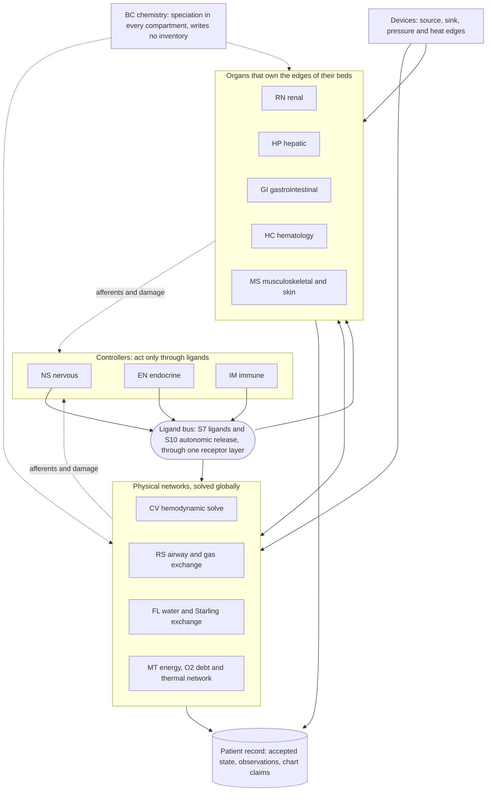
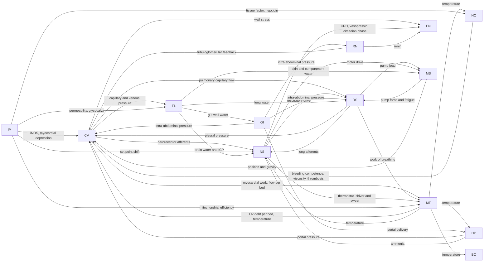
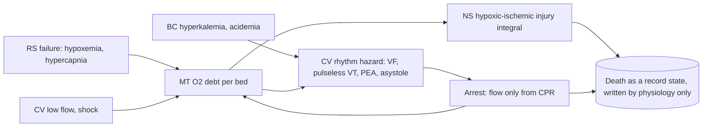

# Coupling map

How the thirteen systems touch each other. Almost every interaction goes through a shared substrate (a pool many systems post to), not through a private wire. Drawn from the arena atlas Part 2 (line 1823) and checked against the DAE atlas ownership collision checklist (line 1403) and both contract drafts.

## Shared substrates

Owned by the body (or the patient record, in contract candidate B), never by a system.

| Id | Substrate | Who may post flux |
|---|---|---|
| S1 | Circulating blood: volume per vascular compartment, pressure derived, flow from the one hemodynamic solve | CV owns the solve; each system owns the edges of its own bed; hemorrhage, infusion and dialysis are explicit edges |
| S2 | Oxygen | RS (alveolar exchange), every tissue through MT (consumption), HC (carrier capacity), BC (speciation only) |
| S3 | Carbon dioxide | MT (production), RS (elimination), BC (speciation only) |
| S4 | Strong ions and weak acids; pH derived | RN, GI, BC (cell shifts), HP, HC, MT (lactate), MS, infusions |
| S5 | Fuels | HP, GI, MT, MS, RN |
| S6 | Heat; temperature derived | MT (owns the thermal network), CV (convection), RS, HP, IM (fever cost), MS |
| S7 | Ligands: hormones, transmitters released into plasma, mediators and drugs | EN, NS, RN, HP, GI, HC, IM, devices (infusion) |
| S8 | Water and osmoles per space | FL (owns distribution and the I&O ledger), RN, GI, RS, BC, MT (sweat), IM (through FL permeability) |
| S9 | Formed elements and factors | HC (owns production and destruction), RN (EPO), HP (factors), GI (iron, B12, folate, vitamin K), IM, MS |
| S10 | Autonomic efferents, as NE and ACh release rates at each target | NS only |

The full post and read table, one row per system, is in the arena atlas at line 1833. Each [card](README.md#cards) repeats its own row.

## Layers

Controllers act only by releasing ligands. Physical networks are solved globally. Organs own the edges of their beds. Chemistry is evaluated in every compartment. Only afferents and damage travel back up, never a computed vital sign.

The observation layer reads the record and posts nothing back to physiology (ADR-67).

## Direct couplings

The only system-to-system wires: afferent signals, mechanical constraints or posted demands, never a vital sign copied across. From the arena atlas table at line 1853.

Not drawn: MT posts tissue PO2 and oxygen debt to every card for injury integrals, MS posts position and interface pressure to RS, NS and GI as events, and EN reaches every card only through free hormone at receptors (S7), so it has no direct wires out.

**Where the substrates live.** In the solver contract ([solver-contract.md](../architecture/solver-contract.md) §1) the substrates sit on an anatomy. Its sites belong to a few classes (capillary bed, vessel segment, junction, enclosed space, tissue site, nerve segment), each site has a height, and containment, flow networks, enclosures and nerve edges join them. A system's laws are written once per site class, so "Starling at every capillary bed" is one law from the pleura to the ankles, and an organ card is a region of the anatomy, not a store. Three arrows above change form without changing the census. Pleural pressure (line 82) and intra-abdominal pressure (line 101) reach the beds as the pressure of the space that encloses them, and position and gravity (line 96) come from site positions under the boundary's posture. ICP (line 111) stays unresolved; once ownership follows mechanism rather than card, it becomes the intracranial enclosure's pressure.

## Tests the map implies

From the arena atlas (line 1892), and enforced by the contract's ownership registry in both drafts:

1. No direct coupling carries a vital sign. Pressures and flows cross as mechanics, never as "MAP".
2. NS, EN and IM reach the body only through S7 and S10, so a new drug is a row on the ligand table and nothing else.
3. Every injury integral reads MT's oxygen debt and the shared temperature.

## Demise paths

Decision [0004](../decisions/0004-demise-is-modeled-physiology.md) needs dying to emerge from these couplings. The main paths in the cards:

Neither contract draft has the discrete modes and hazards this needs yet; see the [synthesis](../council/2026-10-26-contract-pass-1/2026-10-26-contract-pass-1-synthesis.md#gaps-in-both) gap 1 and [decision 0005](../decisions/0005-core-contract-pass-1-choices.md) question 5. How death is defined as a record state is open in decision 0004.
